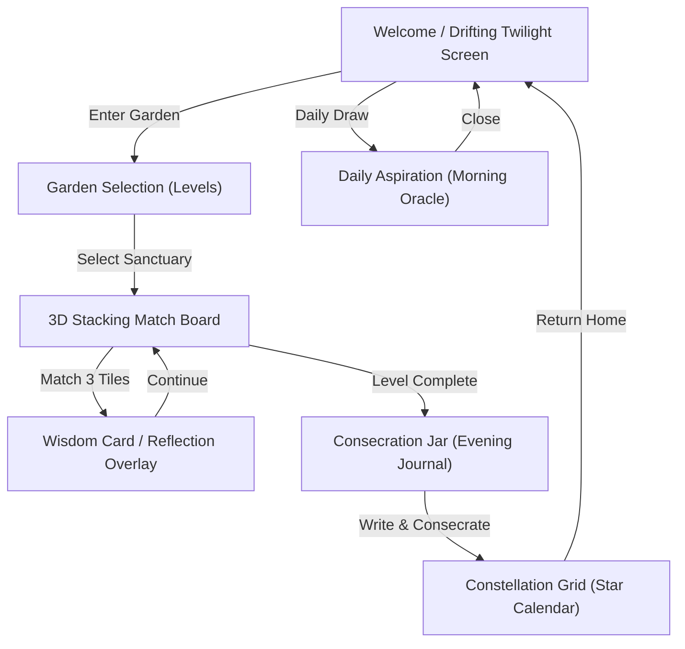

# AuroMatch: The Triple Garden of Significances — UX Flow Document

---

## 1. Interactive Navigation Flow

AuroMatch is designed as a single-page application (SPA) with smooth transitions (cross-fades and slide-ins) to prevent visual noise.

---

## 2. Screen-by-Screen UX Specifications

### 2.1 Screen 1: Welcome Home
* **Intent:** Establish immediate quietness and concentration.
* **Layout:** Centered glassmorphic container set against a dark teal background. Drifting gold particles represent twilight dust.
* **Overlays:**
  * **Onboarding Path Selector:** Loads on first-time launch if no local profile exists. Displays three selection cards: Traditional (Sadhana), Secular (Mindfulness), and Youth (Starlight).
  * **Darshan Day Greeting Card:** Displays dynamically if the device system date matches sacred Ashram anniversaries. Gold-bordered panel with dedicated quotes, fading behind a warm organ chord transition.
* **CTAs:**
  * "Enter the Garden" (navigates to Garden Selection).
  * "Draw Daily Aspiration" (opens morning oracle card).

### 2.2 Screen 2: Garden Sanctuary (Level Selection)
* **Intent:** Frame progression as physical exploration.
* **Layout:** A watercolor map representing four spaces:
  1. *The Samadhi Garden* (Flower tiles)
  2. *The Matrimandir Chamber* (Sanskrit seeds)
  3. *The Ashram Playground* (12 Qualities)
  4. *The Lake Estate* (Indian Instruments)
* **CTAs:** Select a space to load the matching board.

### 2.3 Screen 3: Stacking Matching Board
* **Intent:** Mindful, concentrated matching.
* **Layout:**
  * Top: The 7-slot tray displaying selected tiles sorted by type.
  * Center: Bounded matching area with overlapping 3D tiles. Covered tiles are darkened.
  * Bottom: Status footer ("Tiles Left: X") and "Reshuffle Board" button.
* **Interaction:** Tapping an unblocked tile slides it into the tray.

### 2.4 Screen 4: Wisdom Card (Match Reflection)
* **Intent:** Absorbing the spiritual meaning.
* **Layout:** Glassmorphic panel blurring the board. Displays the matched tile's symbol, name, and quotes. Includes audio control bar.
* **CTAs:**
  * "Listen" (plays slow voice TTS).
  * "Pause" / "Stop" (controls TTS).
  * "Continue" (closes overlay and returns to board).

### 2.5 Screen 5: The Consecration Jar (Journal)
* **Intent:** Surrender of vital friction at the end of a session.
* **Layout:** Serene evening view of the Service Tree. An empty brass jar dominates the center. Below it sits a journal text input.
* **CTAs:** "Consecrate Worry" (triggers the text character dissolution animation into the jar and saves logs, then opens the Constellation calendar).

### 2.6 Screen 6: Constellation Grid (Star Calendar)
* **Intent:** Neutral progress tracking without streaks.
* **Layout:** A night sky grid showing calendar days. Pulse-lit stars indicate logged days. Connecting lines outline the Mother's symbol or a lotus when complete.
* **CTAs:** Tap a lit star to review that day's journal entries and matched tiles; "Return to Home".
