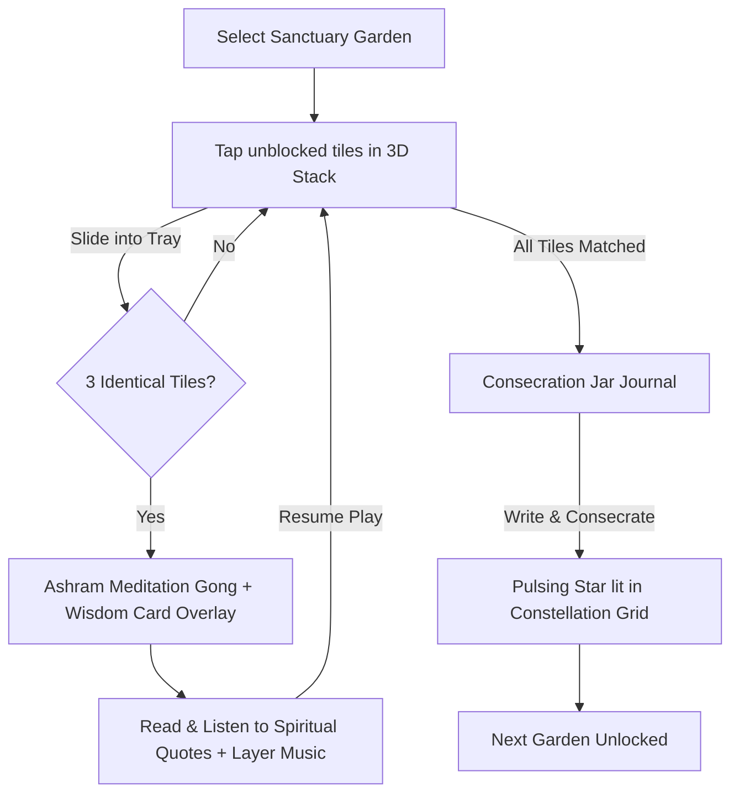

# AuroMatch: The Triple Garden of Significances — Game Design Document (GDD)

---

## 1. The Reflective Game Loop

AuroMatch's game loop is designed to quiet the mind through tactile pattern matching, followed by scriptural contemplation and emotional release.

---

## 2. Core Game Mechanics

### 2.1 3-Tile Matching Stack
* **Occlusion & Dimming:** Tiles are placed on coordinates `(x, y, layer)`. Lower-layer tiles are blocked if overlapping higher-layer tiles exist. Blocked tiles are dimmed and inactive.
* **7-Slot Tray:** Selected tiles move to the tray and sort automatically. Matching sets of 3 removes them immediately.
* **Reshuffle:** If the tray is full (7 slots) and no match is possible, the board plays a low chime and reshuffles all remaining active tiles to guarantee the level can be completed.

### 2.2 Wisdom Card Revelations
* **Contemplative Pause:** Completing a triple opens a full-screen glassmorphic wisdom card containing quotes by the Mother or Sri Aurobindo.
* **Slow Narration (TTS):** Players tap "Listen" to trigger a slow reading (rate `0.70`), ensuring the quote's spiritual depth is absorbed quietly.
* **Secular Toggle:** Allows switching headers from yogic terms (e.g. "Sanskrit Seed Words") to psychological concepts (e.g. "Mindful Sounds") for secular seekers.

### 2.3 Generative Audio & Instrument Layering
* **Raga Drones:** Background audio generates continuous tanpura drones matching the local hour (Dawn = Bhairav, Noon = Sarang, Evening = Yaman, Night = Darbari).
* **Instrument Layering (Set E):** Watercolor instrument tiles (Sitar, Flute, Veena) are matched. Each match adds a corresponding loop of that instrument to the background synthesizer, creating a custom, soothing musical track composed by the user's progress.

---

## 3. Rewards & Consciousness System

AuroMatch avoids competitive scores or daily streaks. Instead, progress is measured as slow expansion:

| Metric | Representation | How to Earn |
| :--- | :--- | :--- |
| **Lotus Petals** | Psychic awakening | Earning $+5$ petals per level assembly. These assemble a vector SVG lotus. |
| **Consciousness Points** | Self-reflection tracking | Earning $+10$ points by consecrating worries in the journal. |
| **Inner Light** | Daily practice tracking | Completed daily reflections light up stars in the monthly calendar. |

### 3.1 The Blooming SVG Lotus
* **Visual Assembly:** Each level completed adds petals to an outlined lotus template on the profile.
* **The Blooming:** Completing a whole garden theme triggers a golden particle explosion and a sustained Ashram meditation gong sound, as the fully assembled lotus runs a slow, glowing scale animation.

### 3.2 Symbol Constellations
* **Monthly Maps:** Logging reflections for a month connects the stars in the calendar. Animated paths trace sacred shapes (Mother's Symbol, Lotus shape, Matrimandir outline) across the sky.

---

## 4. Levels & Difficulty Progression

* **No Locked Content:** Users can explore any Garden Sanctuary at their own pace.
* **Onboarding Path Game Variations:**
  * **Traditional Path:** All tile sets (including Sanskrit Seeds and Sacred Symbols) are available. Headers use original spiritual terms (e.g. "Sadhana Focus").
  * **Secular Path:** Replaces spiritual headers with psychological equivalents (e.g. "Mindfulness Focus") but leaves quote text verbatim.
  * **Youth Path:** Reconstructs the grid to easy tier constraints. It overlays stardust spark animations on tile touches and activates the dynamic SVG lotus petal assembly on the profile view.
* **Garden Themes & Grid Densities:**
  * **Easy (The Samadhi Garden - 24 tiles):** Small grid, 8 flower sets, 1-2 layers. Focuses on simple, direct conversational quotes from the Mother's Questions & Answers.
  * **Medium (The Ashram Playground - 36 tiles):** Concentric circle layout, 12 sets of the 12 Qualities, 2-3 layers. Focuses on written letters and mantras.
  * **Hard (Matrimandir Inner Chamber - 48 tiles):** Complex pyramid layout, 16 sets of Sanskrit seeds and symbols, 3-4 layers. Focuses on dense philosophical passages from Sri Aurobindo's Letters on Yoga.
* **Reshuffle Guarantee:** Users can tap "Reshuffle" at any time to reorganize the board. This preserves matched progress, preventing frustration.
