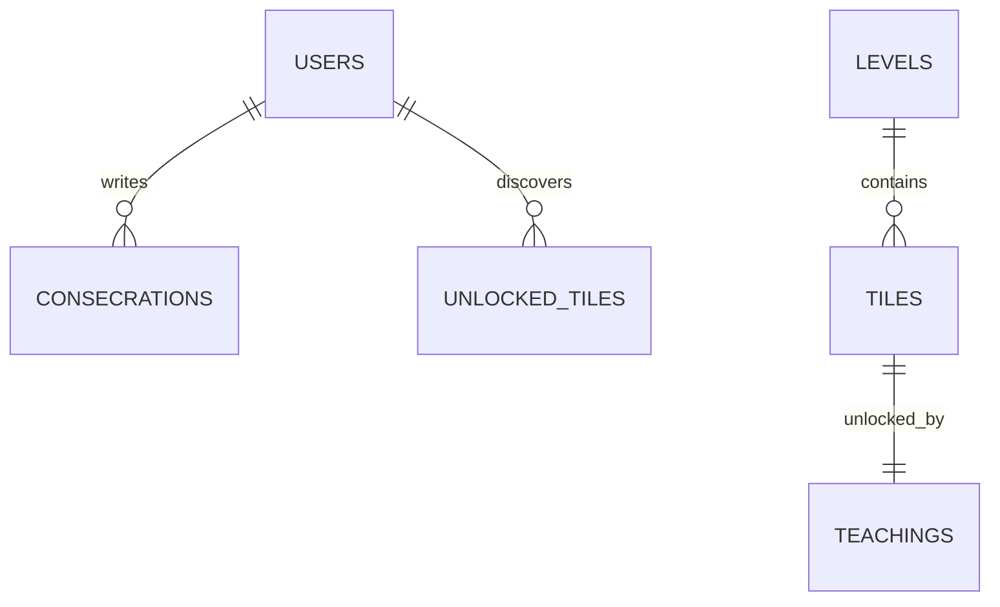

# AuroMatch: The Triple Garden of Significances — Database Design Document

---

## 1. Storage Architecture

To enforce privacy and facilitate offline use, the application avoids external SQL/NoSQL cloud databases and operates strictly in the browser using the **LocalStorage API**. On mobile platforms (Android/iOS), Capacitor.js automatically maps standard Web Storage APIs to native SQLite databases, protecting data from OS cache-wipe sweeps.

All database stores are serialized and stored as JSON strings.



---

## 2. LocalStorage Key-Value Schemas

### 2.1 Store A: `auro_match_user` (User Profile & Levels)
Tracks player progress, accumulated petals, and settings.
```json
{
  "userId": "usr_default_match_2026",
  "levelIndex": 5,
  "lotusPetals": 35,
  "settings": {
    "audioVolume": 0.75,
    "speechNarration": true,
    "voiceName": "fr-FR",
    "secularMode": false,
    "activeThemeSet": "flowers"
  }
}
```

### 2.2 Store B: `auro_match_consecrations` (Consecration Logs)
Stores the player's self-observation journal entries, notes, and the specific qualities surrendered. Indexed by date string (`YYYY-MM-DD`).
```json
{
  "2026-07-17": {
    "inputText": "Felt impatient during the morning team meeting. Consecrating this vital storm to the Mother.",
    "associatedQuality": "Peace",
    "consciousnessPoints": 10,
    "timestamp": 1784307099000
  },
  "2026-07-18": {
    "inputText": "Felt proud after receiving praise. Consecrating this egoistic movement.",
    "associatedQuality": "Humility",
    "consciousnessPoints": 10,
    "timestamp": 1784393499000
  }
}
```

### 2.3 Store C: `auro_match_unlocked_tiles` (Unlocked Lexicon)
Tracks which tiles the user has matched, making them available in the Constellation and Library views.
```json
[
  "lotus_presence",
  "jasmine_purity",
  "rose_devotion",
  "om_seed"
]
```

### 2.4 Store D: `auro_match_teachings` (Cached Thematic Database)
Caches the compiled teachings repository downloaded from the server, alongside the version control checksum.
```json
{
  "version": 102,
  "lastUpdated": "2026-07-18",
  "themes": {
    "flowers": {
      "words": ["lotus_presence", "jasmine_purity", "rose_devotion"],
      "quotes": [
        {
          "id": "lotus_presence",
          "name": "Lotus",
          "quality": "Divine Presence",
          "text": "To feel the Divine presence constantly in all things...",
          "source": "The Mother",
          "book": "Flowers and Their Messages"
        }
      ]
    }
  }
}
```

### 2.5 Store E: `auro_match_events` (Offline Events Database)
Stores the list of Darshan Days and historical milestones for greetings and constellation outlines.
```json
{
  "02-21": {
    "type": "darshan",
    "title": "The Mother's Birthday",
    "description": "Celebration of the birth of the Mother in Paris in 1878.",
    "quoteId": "Q_QUAL_001"
  },
  "08-15": {
    "type": "darshan",
    "title": "Sri Aurobindo's Birthday",
    "description": "Celebration of the birth of Sri Aurobindo in Calcutta in 1872.",
    "quoteId": "Q_SANS_001"
  },
  "12-05": {
    "type": "milestone",
    "title": "Sri Aurobindo's Mahasamadhi",
    "description": "Commemoration of Sri Aurobindo withdrawing from his physical body in 1950.",
    "quoteId": "Q_SANS_002"
  }
}
```

---

## 3. Storage Integrity, Backup & Migration Logic

To ensure smooth client-side operations:
1. **Fallback Initialisation:** If `localStorage.getItem('auro_match_user')` is null, the app automatically injects default configurations and loads the default bundled starter vocabulary.
2. **Version Checks & Non-Destructive Update Merge:**
   * On startup, the app checks if `auro_match_teachings` exists. If the local version is lower than the remote server version, it fetches the remote database.
   * **Merge Rules:** The app updates only the `auro_match_teachings` key (themes, words list, quotes mapping). It **must never touch, reset, or overwrite** the keys holding the player's personal logs (`auro_match_consecrations`, `auro_match_user`, or `auro_match_unlocked_tiles`).
3. **Graceful Error Handling:** If `JSON.parse` fails (e.g., due to local storage corruption), the application catches the error, backs up the corrupt string to `auro_match_corrupt_log`, and initializes empty stores to prevent a complete crash.
4. **Secondary Fallback: Manual Data Portability (Export/Import Backup):**
   * **Export Schema:** The app bundles the player data keys (`auro_match_user`, `auro_match_consecrations`, and `auro_match_unlocked_tiles`) into a single JSON object.
   * **Password-Protected Encryption:** Before generating the download file, the app prompts the user to set a password. The JSON payload is encrypted client-side using AES-256-CBC with a key derived from the password via PBKDF2 (10,000 iterations). 
   * **Import Rules:** When the file `auro_match_backup.json` is uploaded, the app prompts for the password, decrypts the payload, validates the structure, and merges the data.
5. **Primary Recovery Model: OS-Level Auto-Backup (Preferred Integration):**
   * On native mobile platforms (Android/iOS), the Capacitor SQLite plugin is configured to write data files to the OS document directories:
     * Android: `/data/data/com.auro.match/databases/` (Flagged with `android:allowBackup="true"` in the AndroidManifest).
     * iOS: `Documents/` folder (Not flagged with the `NSURLIsExcludedFromBackupKey` attribute).
6. **Device-Bound Storage Encryption (Hardware Key Lock):**
   * To prevent data exposure if the device is lost or the database file is extracted, all personal tables/keys (`auro_match_consecrations`, `auro_match_user`) are encrypted locally.
   * **Encryption Key Generation:** On first launch, the app generates a cryptographically secure random 256-bit AES key.
   * **Hardware Key Enclave:** The key is written directly to the device's secure hardware store:
     - iOS: **Keychain Services** (bound to the device's Secure Enclave).
     - Android: **Android Keystore provider** (bound to the Trusted Execution Environment - TEE).
   * **Data Scrambling:** The database engine encrypts all records using this hardware-locked AES key. If the raw SQLite or LocalStorage files are copied to another device, they cannot be read or decrypted because the unique encryption key cannot be extracted from the original device's hardware.
7. **Absolute Purge & Reset Protocol:**
   * **Trigger Location:** Settings screen under "Reset Sanctuary & Purge All Data".
   * **User Guard:** Displays a high-visibility Caution alert and requires the user to type `"PURGE"` in a text field to enable the action.
   * **Deletion Actions:**
     * Triggers `localStorage.clear()` and drops all SQLite database tables.
     * Deletes the AES master key from the **iOS Keychain** and **Android Keystore**, ensuring any orphaned flash memory blocks can never be decrypted.
     * Redirects to the welcome screen with default configurations.
