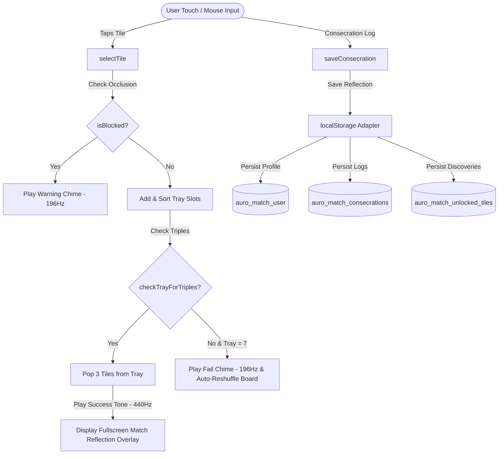
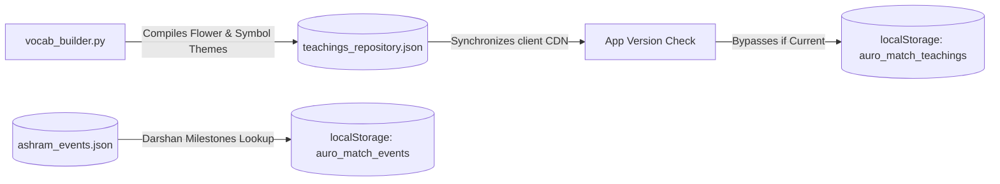
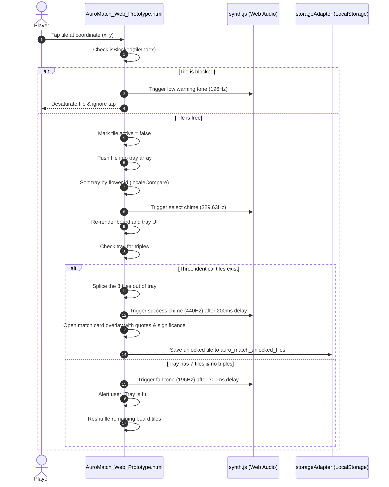
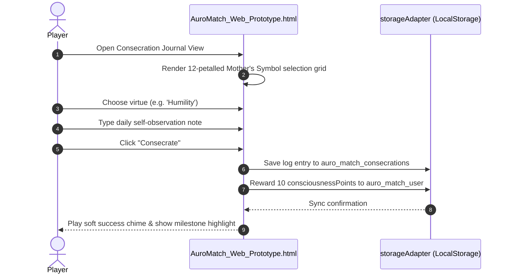

# AuroMatch: The Triple Garden of Significances — Architectural Design Document (HLD & LLD)

This document provides a comprehensive analysis of the **AuroMatch: The Triple Garden of Significances** application's software architecture. It details the High-Level Design (HLD), Low-Level Design (LLD), component schemas, core algorithms, and state machines backboning the application.

---

## 1. Architectural Design Philosophy

AuroMatch is designed as a **local-first, offline-ready, anti-addictive matching concentration sanctuary** built as a lightweight, single-page web prototype. It reverses standard dopamine-loop matching mechanics in favor of quiet contemplation, using pure Vanilla ES6 JavaScript, HTML5 Canvas/SVG, Web Audio API synthesis, and LocalStorage state persistence.

### 🌟 Core sadhanic Objectives
1. **Purity of Mechanics (Cozy Matching)**: Reverse standard dopamine-loop matching mechanics (timers, explosions, levels, daily streaks) in favor of quiet contemplation. Matching 3 tiles pauses the board to reveal a spiritual quote.
2. **Consecration (Surrender of Movements)**: Surrender daily vital struggles (e.g. impatience, ego) in an Evening Consecration Journal, mapping reflections to the 12 qualities of the Mother's symbol.
3. **Lexicon Appreciation (Library & Aksharas)**: Discover watercolor flower qualities, sacred symbols, and Sanskrit seed words (Aksharas), complete with resonant audio recitations and etymological summaries.

### ⚙️ Core Technical Rules
* **Single-File Orchestration**: The web app is structured as a self-contained prototype in [AuroMatch_Web_Prototype.html](file:///c:/DataScience/AuroProject_Annalysis/AuroMatch/AuroMatch_Web_Prototype.html), housing all view templates, styling tokens, Web Audio synthesizer nodes, and JS controllers in a single file to guarantee client-side atomic loading.
* **Respectful Personalities Guardrail**: The physical forms or faces of Sri Aurobindo and the Mother are **never** depicted on tiles to prevent sacred personalities from being treated as game pieces. The Mother’s Symbol remains a stable, unbroken visual anchor.
* **Device Independence**: The app must run entirely offline. Tile quote databases, events calendars, audio synthesis, and save data are local.

---

## 2. High-Level Design (HLD)

### 🏗️ System Architecture & Data Flow

AuroMatch operates on a clean Model-View-Controller (MVC) flow inside the single-page prototype structure:
* **The View**: The HTML5 markup, CSS layout styles (responsive grid layers, tile desaturation, slide-in animations), and inline SVG symbols.
* **The Controllers**: Coordinate 3D coordinate overlapping math, alphabetic tray sorting, sound synth chime triggers, and storage adapter bindings.
* **The Model / Data Layer**: LocalStorage databases containing user progress, consecration logs, and teachings cached repositories.



### 🗄️ Ingestion & Build Pipeline

AuroMatch's vocabulary and quote catalog are generated and synced client-side:



---

## 3. Tech Stack Specification

| Technology Layer | Component / API | Purpose |
| :--- | :--- | :--- |
| **Logic & Engine** | vanilla ES6 JavaScript | Game loop, coordinate check, sorting tray. |
| **Styling & Layout** | CSS CSS Grid, CSS Transitions | Watercolor tile skins, blocked filters, responsive layouts. |
| **Visual Renderers** | SVG (Scalable Vector Graphics), HTML5 Canvas | Watercolor flower icons, calligraphic Aksharas, Matrimandir petals. |
| **Audio Synthesizer** | Web Audio API (`AudioContext`, `OscillatorNode`) | Generative classical drone sounds playing ambient chimes. |
| **Data Persistence** | HTML5 `localStorage` API | Key-value saves (streaks, journals, settings, unlocked levels). |
| **Mobile Compilation** | Capacitor JS Runtime | Native iOS/Android builds mapping SQLite database keys to secure enclaves. |

---

## 4. Low-Level Design (LLD)

### 🛡️ Core Infrastructure & Storage Schema

#### local Storage Key Bindings
The application stores user progress in key-value format inside the browser's local database:

| Key Name | Data Type | Description |
| :--- | :--- | :--- |
| `auro_match_user` | JSON object | User profile (name, levelIndex, lotusPetals, volume settings). |
| `auro_match_consecrations` | JSON object | Keyed by date string (`YYYY-MM-DD`). Stores consecration journals and associated virtues. |
| `auro_match_unlocked_tiles` | Array of strings | Identifiers of all matched tiles unlocked in library. |
| `auro_match_teachings` | JSON object | Cached teachings version catalog and theme list. |
| `auro_match_events` | JSON object | Offline Darshan dates significance mapping. |

#### JSON Schema: Consecration Log (`auro_match_consecrations`)
```json
{
  "2026-08-04": {
    "inputText": "Felt impatient during the morning team meeting. Consecrating this vital storm to the Mother.",
    "associatedQuality": "Peace",
    "consciousnessPoints": 10,
    "timestamp": 1784307099000
  }
}
```

---

### 🧮 Core Algorithms & Mathematical Formulas

#### 1. 3D overlapping Tile Occlusion Algorithm
A tile $i$ at layer $L_i$ with coordinate $(x_i, y_i)$ is marked as **blocked** (covered by tiles in layers above) if there exists any active tile $j$ such that:

$$\begin{aligned}
\text{tile}_j\text{.active} &= \text{true} \\
L_j &> L_i \\
\left| x_j - x_i \right| &< 42\text{ px} \quad (84\% \text{ of tile width } W) \\
\left| y_j - y_i \right| &< 56\text{ px} \quad (85\% \text{ of tile height } H)
\end{aligned}$$

Blocked tiles automatically render with a darker, desaturated filter:
`filter: brightness(0.65) contrast(0.95);`

#### 2. Tray Slot Sorting Algorithm
When a tile is tapped, it slides into the tray. To ensure identical tiles cluster immediately, the tray array is sorted alphabetically on flower ID:

```javascript
gameState.tray.push(selectedTile);
gameState.tray.sort((a, b) => a.flower.id.localeCompare(b.flower.id));
```

#### 3. Chime Pitch Frequencies
Sound effects are synthesized dynamically using the Web Audio API:
* **Failure / Blocked Warning Tone**: Low drone chime ($196\text{ Hz}$).
* **Tile Selection Tone**: Mid-range chime ($329.63\text{ Hz}$).
* **Match Success Tone**: High-pitched chime ($440\text{ Hz}$).

---

## 5. Detailed Component Workflows

### 🕹️ Tile Selection & Matching Lifecycle



---

### 🪷 Consecration Journal Surrender Workflow


