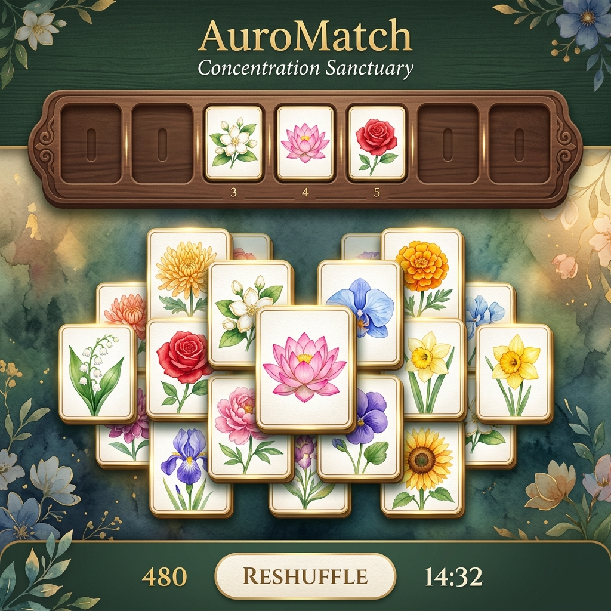
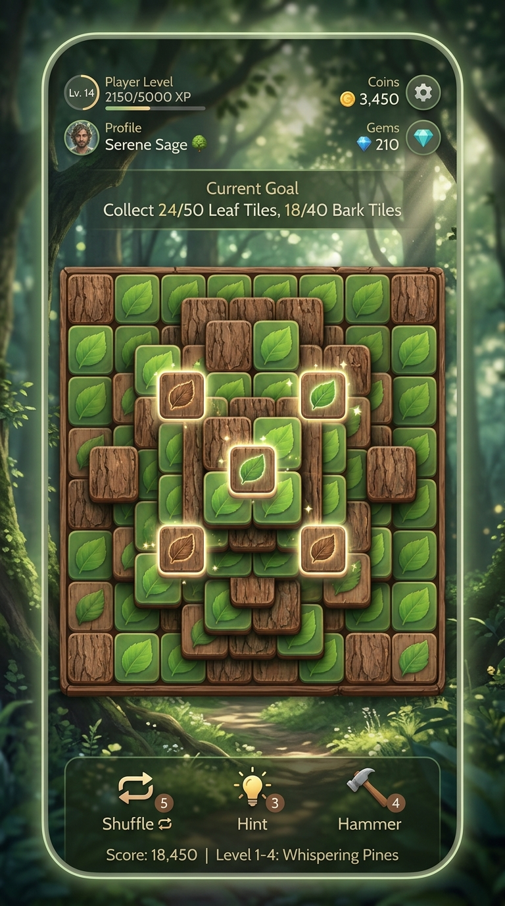
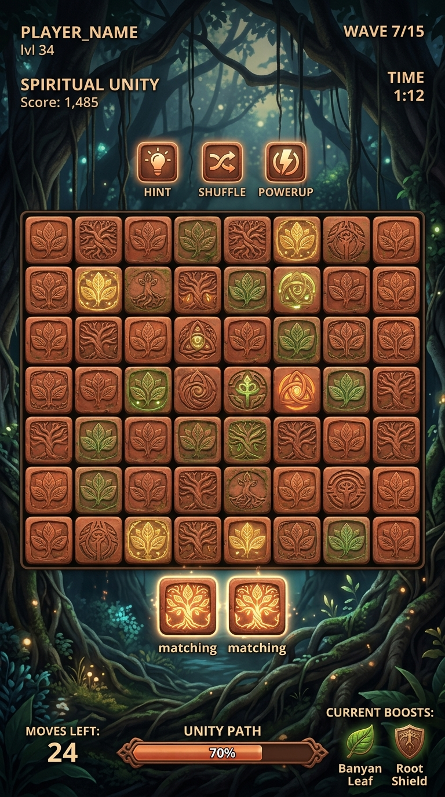
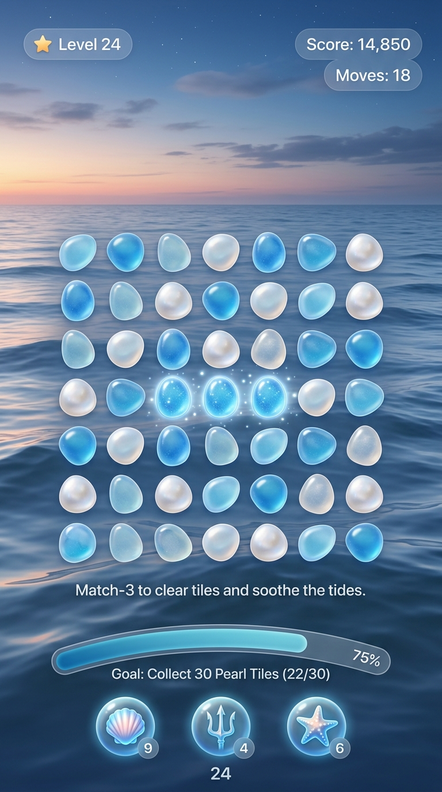
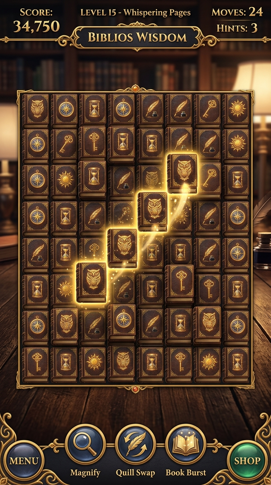
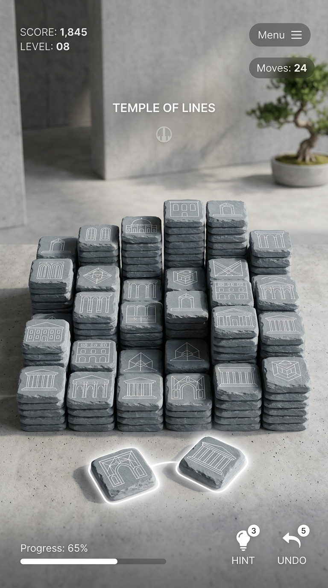
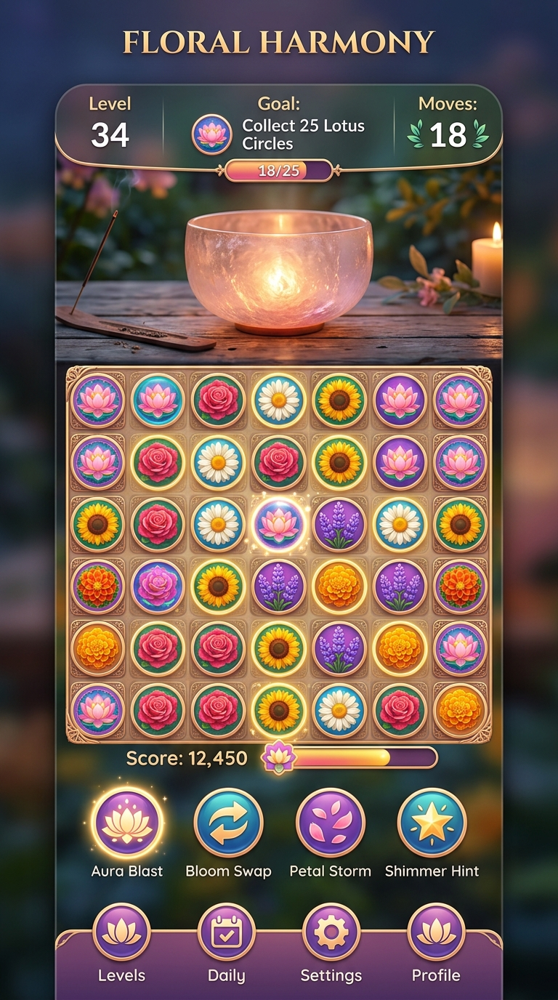
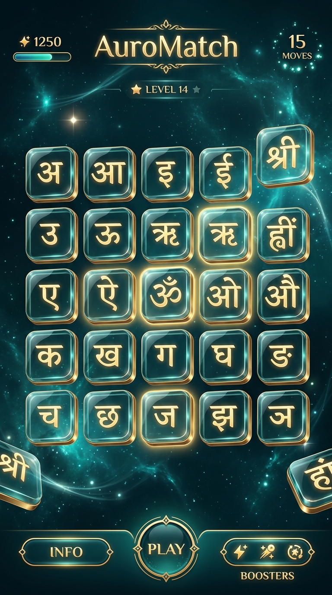
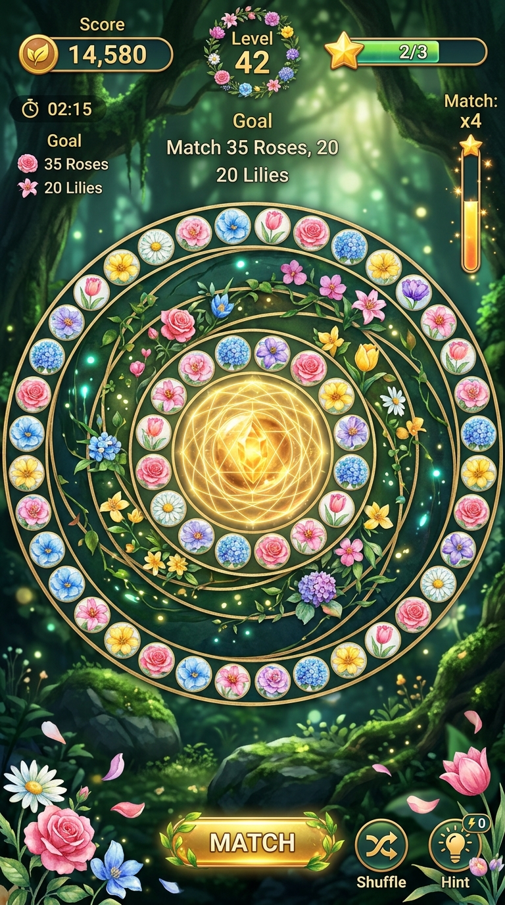
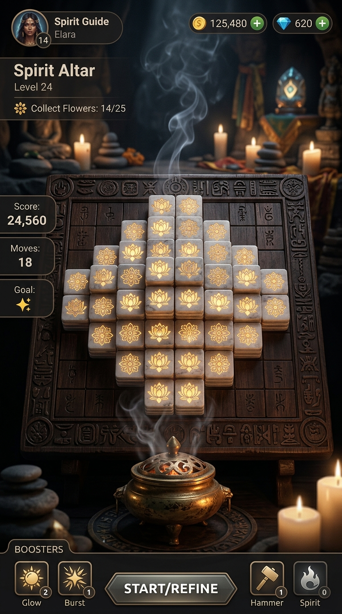

# AuroMatch: 15 Thematic Gardens & Visual Design Specifications

This document consolidates the complete specifications for the **15 Thematic Gardens** and the **3D/Spiritual Visual Rendering Proposals** for AuroMatch, integrating the work of Sri Aurobindo Ashram, SAICE (SAS), Integral Education Schools, Auroville, and SABDA.

---

# Thematic Gardens Catalog
## AuroMatch: The Triple Garden of Significances (Core Content & Asset Specifications)

This catalog details the specific assets, tile sets, visual tokens, spiritual significances, and soundscapes associated with the 15 thematic gardens of **AuroMatch**, centered around Sri Aurobindo Ashram, SAICE (SAS), Auroville, and SABDA.

---

## 1. The Ashram Samadhi Courtyard (Flower Garden)

* **Objective:** Awaken aesthetic sensitivity and connect with psychic receptivity under the shade of the Service Tree at the Ashram Samadhi.
* **Visual Style:** Hand-drawn watercolor outlines on warm parchment background tiles.
* **Acoustic Profile:** Ambient Bansuri (flute) loops layered on the active raga drone.

### Concept Mockup

| Flower Tile ID | Common Name | Botanical Name | Spiritual Significance (The Mother) | Associated Scripture Quote Focus |
| :--- | :--- | :--- | :--- | :--- |
| `lotus_presence` | Lotus | *Nelumbo nucifera* | Divine Presence | A silent, constant aspiration for the Divine Presence in all movements. |
| `jasmine_purity` | Jasmine | *Jasminum* | Purity | Simple, sweet, and direct; opening to the Light without vital demands. |
| `rose_love` | Rose | *Rosa* | Love for the Divine | The complete, unconditional offering of the heart at the feet of the Mother. |
| `hibiscus_power` | Hibiscus | *Hibiscus rosa-sinensis* | Divine Power | The active transforming force descending into the physical nature. |
| `tulsi_devotion` | Tulsi | *Ocimum tenuiflorum* | Devotion | The silent prayer of the vital nature to dedicate itself completely to the Divine. |
| `marigold_wealth` | Marigold | *Tagetes* | Wealth / Abundance | Realizing that material resources are a force meant for the divine work. |
| `zinnia_endurance` | Zinnia | *Zinnia elegans* | Endurance | The capacity to persist quietly in the aspiration, ignoring temporary obstacles. |
| `periwinkle_peace` | Periwinkle | *Vinca rosea* | Peace in the Vital | Establishing a quiet, undisturbed calm in the nervous and emotional nature. |

---

## 2. The Ashram Playground (The 12 Qualities)

* **Objective:** Cultivate the 12 qualities necessary for the transformation of nature at the Ashram Playground, where the Mother gave her evening talks.
* **Visual Style:** Flat vector medallions colored in the specific spiritual colors assigned by the Mother.
* **Acoustic Profile:** Resonant Veena (string) loops layered on the active raga drone.

| Petal Tile ID | Quality (Virtue) | Spiritual Color (The Mother) | Hex Token | Spiritual Meaning & Focus |
| :--- | :---: | :--- | :--- | :--- |
| `qual_sincerity` | Sincerity | Pale Blue | `#add8e6` | Aligning all thoughts, words, and actions with the soul's truth. |
| `qual_humility` | Humility | Deep Blue | `#00008b` | The recognition that the ego is nothing, opening to the Divine grace. |
| `qual_gratitude` | Gratitude | Pale Green | `#90ee90` | The quiet, joyful appreciation of the Divine's constant guidance. |
| `qual_perseverance` | Perseverance | Green | `#008000` | The steady, unshakeable effort that goes on despite delays or failures. |
| `qual_aspiration` | Aspiration | Orange | `#ffa500` | The flame of the soul calling for the descent of the Light and Truth. |
| `qual_receptivity` | Receptivity | Light Yellow | `#ffffe0` | The quietness that allows the Divine force to enter and work in the nature. |
| `qual_progress` | Progress | Deep Yellow | `#ffd700` | The constant effort to grow, renew oneself, and rise to a higher plane. |
| `qual_courage` | Courage | Red | `#ff0000` | The inner strength to face all difficulties without fear or vital worry. |
| `qual_goodness` | Goodness | Salmon Pink | `#fa8072` | The spontaneous desire to be helpful, kind, and sweet to all beings. |
| `qual_generosity` | Generosity | Violet | `#ee82ee` | The giving of oneself and one's resources without demanding return. |
| `qual_equality` | Equality | Grey / White | `#d3d3d3` | Remaining quiet, undisturbed, and identical in face of praise or blame. |
| `qual_peace` | Peace | Gold / White | `#faf0e6` | The deep, unshakeable quietude in which the Divine work is done. |

---

## 3. The Auroville Matrimandir Chamber (Sanskrit Seeds)

* **Objective:** Quiet the mental screen in the silent inner chamber of the Matrimandir, concentrating on the vibrations of Sanskrit seed sounds.
* **Visual Style:** Bold Devanagari calligraphy written in black ink on gold-leaf parchment tiles.
* **Acoustic Profile:** Heavy, low-frequency bronze bells and slow vocal chanting.

| Calligraphy Tile ID | Sanskrit Akshara | Transliteration | Spiritual Meaning | Mantric Focus |
| :--- | :---: | :--- | :--- | :--- |
| `sans_om` | ॐ | *AUM* | The Infinite / Cosmic Source | The primordial sound containing the seed of all manifestation. |
| `sans_shanti` | शान्तिः | *Shanti* | Peace | Quietening the mental, vital, and physical planes of the being. |
| `sans_jyoti` | ज्योतिः | *Jyoti* | Light | The spiritual light that descends to guide and purify the consciousness. |
| `sans_satya` | सत्यम् | *Satyam* | Truth | The divine reality that stands behind all external forms. |
| `sans_ananda` | आनन्दः | *Anandam* | Bliss | The deep, self-existent joy of the soul, independent of outer circumstances. |
| `sans_prem` | प्रेम | *Prema* | Divine Love | The pure, ego-free love that unites all existence with the Divine. |
| `sans_tapas` | तपस् | *Tapas* | Concentrated Force | The fire of spiritual concentration that purifies and transforms the nature. |
| `sans_dharma` | धर्मः | *Dharmah* | Right Action | Living and acting in alignment with the inner truth of the soul. |

---

## 4. The Ashram Farms & Lake Estate (Indian Instruments)

* **Objective:** Explore the silent, physical work of the Ashram farms layered with traditional acoustic instruments, building a custom soundtrack.
* **Visual Style:** Gold-bronze vector outlines representing traditional Indian classical instruments.
* **Acoustic Profile:** Triggers independent, synchronized major-7th loops of that instrument, layering on top of the background raga drone.

| Instrument Tile ID | Instrument | Visual Asset representation | Audio Loop Description (Synthesized) |
| :--- | :--- | :--- | :--- |
| `inst_sitar` | Sitar | Plucked stringed instrument with a gourd chamber | Slow, rhythmic plucked sitar notes in major-7th chords. |
| `inst_bansuri` | Flute (Bansuri) | Bamboo transverse flute | Meditative, low-register wooden flute air-breath loops. |
| `inst_veena` | Veena | Large double-gourd stringed instrument | Deep, resonant plucked chords with sliding pitch bends. |
| `inst_harmonium` | Harmonium | Reed keyboard organ box | Warm, steady air bellows generating sustained background chords. |
| `inst_tanpura` | Tanpura | Four-stringed fretless backing lute | Continuous plucked backing string drone. |
| `inst_tabla` | Tabla | Pair of hand drums (Dayan and Bayan) | Very soft, muted clay-pot hand drum resonance. |
| `inst_bell` | Singing Bowl | Hammered metallic singing bowl | Rich, crystalline rim-rubbed singing bowl resonance. |

---

## 5. The Ashram Service Tree (Psychic Aspiration)

* **Objective:** Cultivate vertical psychic aspiration, silent growth, and inner alignment under the protection of the Service Tree.
* **Visual Style:** Tiles textured like rustic bark wood and soft green leaves, placed in organic layers.
* **Acoustic Profile:** Wind-harp strings and blowing bamboo wind chimes.

### Concept Mockup

| Leaf Tile ID | Quality Name | Botanical Context | Spiritual Meaning & Focus |
| :--- | :--- | :--- | :--- |
| `serv_aspiration` | Aspiration | Service Tree Leaves | The constant call of the being for the descent of the Divine Consciousness. |
| `serv_receptivity` | Receptivity | Sun-drenched Canopy | The opening of the mind and body to receive the quiet peace. |
| `serv_faith` | Faith | Deep Anchor Roots | The unshakeable confidence in the victory of the Divine Grace. |
| `serv_surrender` | Surrender | Drooping Branches | Offering one's vital choices and will at the feet of the Divine. |
| `serv_trust` | Trust | Inner Bark Protection | The peaceful certainty that the Mother directs all occurrences for progress. |
| `serv_sincerity` | Sincerity | Pure sap flow | Simple transparency of the vital nature without hidden desires. |
| `serv_peace` | Peace | Still Shade Area | The silence in which no external agitation can enter. |
| `serv_joy` | Joy | Blooming Golden Flowers | The quiet bliss of the soul resting in the Divine presence. |

---

## 6. The Auroville Banyan Tree (Unified Consciousness)

* **Objective:** Foster unified consciousness, interconnectedness, and collective harmony under the geographic center of Auroville.
* **Visual Style:** Warm terracotta clay tablets with banyan leaf and root carvings.
* **Acoustic Profile:** Ambient forest birds, rustling leaf background generators, and soft Esraj (bowed string) chords.

### Concept Mockup

| Clay Tile ID | Concept Name | Root Context | Spiritual Meaning & Focus |
| :--- | :--- | :--- | :--- |
| `bany_harmony` | Harmony | Intertwining aerial roots | Establishing a sweet, collaborative rhythm in collective action. |
| `bany_peace` | Peace | Vast shade canopy | Maintaining a quiet, unshakeable sanctuary within the community. |
| `bany_brotherhood` | Brotherhood | Branch connections | Recognizing the same Divine spark inside all companions. |
| `bany_collaboration` | Collaboration | Root merging | Working together for the divine work without vital ego competition. |
| `bany_goodwill` | Goodwill | Soil nourishment | The spontaneous wish for everyone's spiritual growth and progress. |
| `bany_sympathy` | Sympathy | Sap distribution | Resonating in quiet, helpful understanding with another's movements. |
| `bany_oneness` | Oneness | The single trunk base | Realizing that all manifestation is a diverse expression of the One. |

---

## 7. The Pondicherry Coastline (The Infinite Ocean)

* **Objective:** Expand the mental bounds to experience vastness, quietude, and the quiet surrender of the vital mind where Sri Aurobindo first arrived.
* **Visual Style:** Polished blue and pearl-white seaglass tablets.
* **Acoustic Profile:** Soft ocean wave synthesizer washes and low, slow wooden flutes.

### Concept Mockup

| Glass Tile ID | Wave Movement | Shore Context | Spiritual Meaning & Focus |
| :--- | :--- | :--- | :--- |
| `coast_vastness` | Vastness | Horizon line | Expanding the consciousness beyond the narrow limits of the ego. |
| `coast_quietude` | Quietude | Still low tide | Silencing the mental screen, leaving it wide and empty like the sea. |
| `coast_depth` | Depth | Deep ocean trenches | Standing back into the silent witness consciousness (Purusha). |
| `coast_calm` | Calm | Smooth water surface | Undisturbed peace that remains intact despite vital storms. |
| `coast_tide` | Tide | Rising tide force | The steady, powerful movement of aspiration lifting the nature. |
| `coast_wave` | Wave | Cresting wave peaks | Observing thoughts rise and fall as simple movements on the surface. |
| `coast_flow` | Flow | Current streams | Yielding the vital nature to the quiet current of the Divine Grace. |
| `coast_reflection` | Reflection | Moonlight on water | Keeping the mind quiet so it reflects only the Light from above. |

---

## 8. SABDA & The Ashram Library (Concentration of Wisdom)

* **Objective:** Awaken intellectual clarity, focused study, and the silent inner light of wisdom through SABDA's book distributions and the Ashram Library.
* **Visual Style:** Thick tiles shaped like old leather-bound books with detailed gold filigree page edges.
* **Acoustic Profile:** The quiet rustle of shifting parchment pages and a soft pendulum clock strike.

### Concept Mockup

| Book Tile ID | Book Name | Core Aspiration | Spiritual Focus |
| :--- | :--- | :--- | :--- |
| `lib_divine` | The Life Divine | Intellectual Ascent | Conceptualizing the manifestation of the supermind on earth. |
| `lib_savitri` | Savitri | Mantric Revelation | Experiencing the cosmic journey of the soul through mantric poetry. |
| `lib_synthesis` | Synthesis of Yoga | Integral Practice | Unifying the yogas of works, knowledge, and love into one movement. |
| `lib_mother` | The Mother | Surrender & Grace | Opening the nature to the four great aspects of the Mother. |
| `lib_letters` | Letters on Yoga | Practical Guidance | Direct, conversational advice for daily yogic difficulties. |
| `lib_education` | On Education | Complete Growth | Integrating physical, vital, mental, and psychic education. |
| `lib_words` | Words of the Mother | Pure Aphorism | Meditating on short, powerful statements of spiritual truth. |
| `lib_gita` | Essays on the Gita | Synthesized Action | Acting in the world as an instrument of the Divine Will. |

---

## 9. The Ashram Golconde Dormitory (Modernist Harmony)

* **Objective:** Cultivate physical order, structural beauty, material perfection, and zen-like peace at the historic Golconde.
* **Visual Style:** Minimalist slate tablets in concrete grey with clean architectural lines.
* **Acoustic Profile:** Gentle water droplets and soft bronze wind chimes.

### Concept Mockup

| Slate Tile ID | Design Aspect | Architectural Detail | Spiritual & Practical Focus |
| :--- | :--- | :--- | :--- |
| `golc_symmetry` | Symmetry | Monolithic structure | Finding visual balance and order in the physical environment. |
| `golc_silence` | Silence | Soundproof louvers | Quieting the external vital chatter to connect with the inner calm. |
| `golc_light` | Light | Indirect sun angles | Allowing the light to enter the room without heat or glare. |
| `golc_utility` | Utility | Integrated furniture | Reducing clutter; keeping only what is helpful and beautiful. |
| `golc_cleanliness` | Cleanliness | Polished stone floors | Keeping the physical instrument pure, neat, and organized. |
| `golc_harmony` | Harmony | Landscaped gardens | Unifying physical shelter with surrounding natural trees and ponds. |
| `golc_perfection` | Perfection | Exposed raw concrete | Doing physical work with absolute care, accuracy, and beauty. |
| `golc_peace` | Peace | Zen-like corridors | Walking and resting in a space of quiet, undisturbed shelter. |

---

## 10. The Ashram Archives & Research Department (Sadhaks' Letters)

* **Objective:** Cultivate the sincerity of daily letter writing and self-observation preserved in the Ashram Archives.
* **Visual Style:** Faded ink calligraphy on hand-pressed paper tiles.
* **Acoustic Profile:** Soft scratching of a fountain pen and low pipe organ chords.

| Paper Tile ID | Document Type | Historical Context | Yogic & Self-Observation Focus |
| :--- | :--- | :--- | :--- |
| `arch_letter` | Letter to Sri Aurobindo | Daily sadhana queries | Expressing inner difficulties with absolute sincerity and truth. |
| `arch_diary` | Sadhak's Diary | Personal logbooks | Writing daily records of vital movements and speech controls. |
| `arch_mantra` | Hand-written Mantra | Ink-written guides | Committing sacred words to paper to remember during daily actions. |
| `arch_envelope` | Blessing Envelope | Flower-sealed packets | Receiving and keeping the protective spiritual force. |
| `arch_scrap` | Scrapbook Note | Short spiritual quotes | Pinning key messages on the desk to remind during study hours. |
| `arch_ledger` | Work Ledger | Ashram service tracking | Organizing collective service tasks as an offering to the Mother. |
| `arch_sketch` | Watercolor Sketch | Flower illustrations | Painting flower shapes to meditate on their psychic significances. |
| `arch_draft` | Book Draft | Hand-written corrections | Developing the mental clarity to write and formulate truth. |

---

## 11. The Auroville Matrimandir Petals (12 Gardens of the Chamber)

* **Objective:** Meditate on the 12 specific spiritual gardens surrounding the Matrimandir, mapping individual virtues.
* **Visual Style:** Concentric flower beds of the actual flowers planted in each garden.
* **Acoustic Profile:** High-pitch quartz crystal singing bowls.

### Concept Mockup

| Garden Tile ID | Garden Name | Primary Flower | Core Spiritual Focus |
| :--- | :--- | :--- | :--- |
| `pet_harmony` | Harmony | Hibiscus | Establishing a collective agreement without vital ego clashes. |
| `pet_perfection` | Perfection | Rose | Doing all works with absolute beauty, care, and exactitude. |
| `pet_youth` | Youth | Periwinkle | Maintaining a progressive, plastic mind open to continuous growth. |
| `pet_progress` | Progress | Zinnia | The steady effort to rise above prior limits on every plane. |
| `pet_courage` | Courage | Red Hibiscus | Facing inner and outer difficulties with complete trust. |
| `pet_goodness` | Goodness | Salmon Hibiscus | Radiating a sweet, helpful, and kind attitude to all beings. |
| `pet_generosity` | Generosity | Violet flower | Giving of oneself and one's force without demanding return. |
| `pet_equality` | Equality | White Rose | Remaining identical and calm in face of success or difficulty. |
| `pet_peace` | Peace | Golden Marigold | Establishing a deep, undisturbed quiet in the mental screen. |
| `pet_sincerity` | Sincerity | Pale Blue Hibiscus | The basic requirement of aligning action with the soul's truth. |
| `pet_humility` | Humility | Deep Blue flower | The total absence of vanity, recognizing the Divine Grace. |
| `pet_gratitude` | Gratitude | Light Green flower | The joyful, silent appreciation of the Divine's protection. |

---

## 12. The Auroville Green Belt (Natural Afforestation)

* **Objective:** Connect with afforestation and wildlife protection in Auroville's surrounding Green Belt.
* **Visual Style:** Textured wood-bark tiles with silhouettes of native birds and deer.
* **Acoustic Profile:** Rustling leaves, morning birds chirping, and soft woodwind notes.

| Forest Tile ID | Element | Forest Context | Spiritual & Ecological Focus |
| :--- | :--- | :--- | :--- |
| `fore_soil` | Soil | Red laterite earth | Grounding and preparing the physical body to receive the force. |
| `fore_sapling` | Sapling | Local evergreen trees | Nurturing new movements of spiritual progress with patience. |
| `fore_water` | Water | Rain catchment basins | Conserving vital energies, saving resources for the divine work. |
| `fore_shade` | Shade | Canopy layer | Providing silent shelter and peace to neighboring companions. |
| `fore_bird` | Bird | Paradise Flycatcher | The aspiration of the vital nature to fly towards the Light. |
| `fore_seed` | Seed | Native tree pods | The silent potential of transformation resting in the heart. |
| `fore_root` | Root | Deep root structures | Anchoring the consciousness in unshakeable trust and faith. |
| `fore_wildlife` | Wildlife | Spotted deer | Cultivating a gentle, quiet, and non-violent physical nature. |

---

## 13. Sri Aurobindo International Centre of Education & Integral Education Schools (SAICE/SAS/Integral School Classroom)

* **Objective:** Cultivate child-like simplicity, joyful enthusiasm, sportsmanship, and mental focus of SAICE (SAS) and Integral School students, embodying Sri Aurobindo's fivefold system of Integral Education.
* **Visual Style:** Bright chalk sketches drawn on slate blackboard tiles.
* **Acoustic Profile:** High-pitched, playful handbell chimes.

| Slate Tile ID | Activity | Classroom Context | Spiritual & Physical Focus |
| :--- | :--- | :--- | :--- |
| `sch_focus` | Study | Mental concentration | Gathering the scattered attention to absorb truth cleanly. |
| `sch_play` | Sports | Athletics / Playground | Keeping the physical body strong, flexible, and responsive. |
| `sch_art` | Art | Painting / Music | Refining the aesthetic sense, expressing harmony in form. |
| `sch_laughter` | Laughter | Collective play | Cultivating a cheerful, sunny vital nature free from gloom. |
| `sch_friendship` | Friendship | Shared benches | Learning to live and work in cooperative harmony with others. |
| `sch_fairplay` | Fairplay | Game rules | Honesty in action, respecting others without jealousy. |
| `sch_enthusiasm` | Enthusiasm | Morning assembly | The joyful energy to learn, improve, and progress. |
| `sch_simplicity` | Simplicity | Plain chalk lines | Staying free from artificial vanity and vital demands. |

---

## 14. The Pondicherry Botanical Garden (Exotic Flora)

* **Objective:** Explore rare exotic flora, aligning scientific discovery with spiritual appreciation.
* **Visual Style:** Vintage botanical print illustrations with detailed leaf vein textures.
* **Acoustic Profile:** Soft rainforest rain synthesizer washes.

| Plant Tile ID | Flora Class | Garden Context | Botanical & Contemplative Focus |
| :--- | :--- | :--- | :--- |
| `bot_orchid` | Orchid | Glasshouses | Recognizing the intricate, delicate beauty of natural designs. |
| `bot_fern` | Fern | Damp shade valleys | The capacity to grow quietly in hidden, humble places. |
| `bot_bamboo` | Bamboo | Tall bamboo groves | Flexing with vital storms, remaining empty inside to transmit force. |
| `bot_succulent` | Succulent | Sandy flower beds | Storing vital force, enduring dry periods with quiet patience. |
| `bot_palm` | Palm | Palm avenues | A tall, straight aspiration reaching towards the sun. |
| `bot_waterlily` | Waterlily | Lily ponds | Rising above muddy water to bloom in pristine purity. |
| `bot_creeper` | Creeper | Pergolas | The vital nature climbing and clinging to the Divine protection. |
| `bot_shrub` | Shrub | Border hedges | Serving as a quiet, dense barrier of peace and order. |

---

## 15. The Ashram Dining Hall (Consecrated Service)

* **Objective:** Cultivate physical purification, service as offering, and conscious eating habits at the Ashram Dining Hall.
* **Visual Style:** Polished brass platter shapes containing grains and fruit drawings.
* **Acoustic Profile:** Gentle clanking of metal bowls and soft Vedic chanting.

| Service Tile ID | Food / Work | Dining Hall Context | Purifying & Offering Focus |
| :--- | :--- | :--- | :--- |
| `din_rice` | Rice | Cooked steam grains | Conscious eating, receiving food as a gift to sustain the body. |
| `din_milk` | Milk | Brass cups | Receiving pure nourishment with gratitude and calm. |
| `din_banana` | Fruit | Daily bananas | Keeping the body healthy, light, and responsive. |
| `din_brass` | Brass Bowl | Dining utensils | Simplicity in habits, keeping physical objects clean and pure. |
| `din_service` | Serving | Food line service | Serving others with quiet joy, without vital preferences. |
| `din_silence` | Silence | Quiet eating areas | Eating in calm contemplation, avoiding vital talk and gossip. |
| `din_offering` | Offering | Dining altar | Consecrating the food to the Divine presence inside the body. |
| `din_cleaning` | Cleaning | Washing area | Treating physical cleaning work as a sacred spiritual practice. |

---

# Visual Design Concepts & Mockups
## AuroMatch: The Triple Garden of Significances (3D & Spiritual Visual Proposals)

This document outlines three proposed visual design directions for **AuroMatch**, integrating 3D layout visual depth, spiritual texts, and aesthetic concentration themes.

---

## Concept 1: The Golden Aura 3D Glass Stack

### Visual Description
A minimalist, premium interface set in a deep, dark cosmic space. Tiles resemble polished glass tablets with golden-beveled edges. Active tiles emit a soft, pulsing golden aura, while blocked tiles are dark, metallic, and semi-transparent. matched Sanskrit letters float upwards in glowing 3D outlines.

### Proposed Rendering Tech
* **WebGL/Three.js:** Renders the tiles as 3D meshes with glass refraction and gold bevel shaders.
* **CSS 3D Transforms:** An offline fallback using `transform: translate3d()` and custom CSS box-shadow glow.

### Concept Mockup

---

## Concept 2: The Blooming Mandala Garden

### Visual Description
A concentric circular matching board inspired by the Mother's 12-petaled symbol. At the center sits a glowing golden crystal sphere. Flower and quality tiles are arranged along circular paths. Matching tiles triggers a blooming animation where 3D watercolor flowers grow on the outer rings of the mandala.

### Proposed Rendering Tech
* **SVG Layering + CSS Animation:** The concentric paths are managed as SVG vector tracks. Triggering a match activates path stroke-draw animations.
* **Canvas API:** Renders particle blooms and blooming flower transitions.

### Concept Mockup

---

## Concept 3: The Brass Altar & Consecration Fire

### Visual Description
A highly tactile, photorealistic wood-and-stone altar. The matching board is a dark teak wood surface. Tiles are thick, physical slabs carved out of white marble or terracotta clay, with gold-inlay flower shapes. The Consecration Jar is a physical brass incense burner. Written reflections dissolve into 3D smoke wisps drifting into the burner.

### Proposed Rendering Tech
* **CSS Shaders & Bump Mapping:** Teak wood and marble textures are mapped onto CSS grids using high-resolution normal maps to react to drag touch shadows.
* **HTML5 Canvas Particle Fluid Simulation:** Simulates organic wisp movement for the consecration smoke.

### Concept Mockup

