# AuroMatch: The Triple Garden of Significances — Master Technical & Design Blueprint (The Bible)

This document serves as the single source of truth (the "Bible") for the **AuroMatch: The Triple Garden of Significances** application. It details the complete system architecture, block-by-block screen logic, interactive math, audio synthesis, database design, and the automated cloud-crawling sitemap update pipeline. All engineering, styling, and progression specifications must align with this blueprint.

---

## 1. System Architecture & Technology Stack

AuroMatch is designed as a hybrid client-side web application wrapped in a native cross-platform shell. This guarantees high performance, complete offline capabilities, absolute data privacy, and a unified codebase.

```text
                                  +------------------------------------+
                                  |    Automated GitHub Actions Crawler |
                                  |   (Scans Ashram site, builds JSON) |
                                  +------------------┬-----------------+
                                                     │
                                                     ▼
                                  +------------------------------------+
                                  |         Hosted Version CDN         |
                                  |    (version.json & teachings.json)  |
                                  +------------------┬-----------------+
                                                     │
                                                     ▼ (Async Version Sync on Launch)
+─────────────────────────────────────────────────────────────────────────────────────────────+
|                                    Capacitor.js Wrapper                                     |
|                                                                                             |
|   +─────────────────────────+     +─────────────────────────+     +───────────────────────+ |
|   |        UI Layer         |     |    State & Logic Layer  |     |     Engine Layer      | |
|   |  - Mobile Viewport (1:1)|     |  - Stack Occlusion Check|     |  - Web Audio (Ragas)  | |
|   |  - Desktop Centered Box |     |  - Tray Sort Clustering |     |  - Web Speech (TTS)   | |
|   +────────────┬────────────+     +────────────┬────────────+     +───────────┬───────────+ |
|                │                               │                              │             |
|                ▼                               ▼                              ▼             |
|   +───────────────────────────────────────────────────────────────────────────────────────+ |
|   |                                  Persistence Layer                                    | |
|   |  - Browser LocalStorage (Fallback for Web)                                            | |
|   |  - Native SQLite Storage (Mapped by Capacitor for Android/iOS)                        | |
|   +───────────────────────────────────────────────────────────────────────────────────────+ |
+─────────────────────────────────────────────────────────────────────────────────────────────+
```

### 1.1 The Web-Native Stack
* **Core Logic:** Vanilla JavaScript (ES6+) driving 3D stack coordinate calculations.
* **Vector Graphics:** SVG (Scalable Vector Graphics) for rendering quality medallions and the profile progress lotus.
* **Particle Layer:** HTML5 Canvas API driving stardust drift and Consecration Jar text dissolution animations.
* **Audio Synthesis:** Web Audio API (Low-level synthesis of oscillator nodes for gongs, drones, and instrument loops).
* **Narration System:** Web Speech API (`SpeechSynthesis`) with slow-cadence speech configurations.

### 1.2 Cross-Platform Wrapper (Capacitor.js)
To target Android, iOS, and PC browsers, the app utilizes **Capacitor.js**:
* **Mobile Shells:** Capacitor wraps the code into native Java (Android APK) and Swift (iOS IPA) wrappers.
* **Storage Mapping:** On Android and iOS, Capacitor intercepts standard Web Storage APIs (`localStorage`) and redirects them to a local SQLite database file, preventing the mobile OS from clearing player data during storage cleaning sweeps.
* **PC Browser:** The code compiles as a standard static HTML web page, hosted on a CDN (like GitHub Pages).

---

## 2. Ingestion & Content Lifecycle (Automated GitHub Scout)

To keep the vocabulary and teachings dynamic and synchronized with the Ashram's updates, the platform utilizes an automated cloud ingestion and client-side sync pipeline.

### 2.1 Complete Ingestion & Synchronization Flow

```mermaid
graph TD
    %% Server-Side Ingestion (Cloud)
    subgraph Cloud [GitHub Actions Ingestion - Once a Week]
        C1["Trigger: Weekly Cron Job"] --> C2["Scout: Fetch Ashram Sitemap / Book Directories"]
        C2 --> C3{"State Check: Read .corpus_state.json"}
        C3 -->|No Changes / Same File Hashes| C4["End Workflow (Do Nothing)"]
        C3 -->|New Book / Modified File Hash| C5["Download Text/PDF Book File"]
        C5 --> C6["Parse Text: Tokenize & Clean Stop Words"]
        C6 --> C7["Classify Words: Map to Spiritual Themes"]
        C7 --> C8["Compile Database: Update teachings_repository.json & version.json"]
        C8 --> C9["Commit & Push: Host updated files on CDN (GitHub Pages)"]
    end

    %% Client-Side Synchronization (App)
    subgraph Client [Client App Sync - On Launch]
        A1["User Launches App Online"] --> A2["Fetch version.json from CDN"]
        A2 --> A3{"Compare Version Checksum"}
        A3 -->|Local Version == Server Version| A4["Skip Download & Load Local Cache"]
        A3 -->|Server Version > Local Version| A5["Download teachings_repository.json from CDN"]
        A5 --> A6["Decoupled Merge: Write new vocabulary & quotes to local storage"]
        A6 --> A7["Preserve Logs: Retain user reflections, stars, and petals keys untouched"]
        A4 --> A8["Start Meditative Gameplay (Offline Mode)"]
        A7 --> A8
    end
```



### 2.2 Verbose Ingestion Engine Specifications (Cloud Crawler)
* **Process:** The GitHub Actions runner boots a Python environment and reads the sitemap files of standard websites (e.g. sitemap of `motherandsriaurobindo.org`).
* **Word Extraction & Classification:** The parser tokenizes vocabulary terms (qualities, flowers, symbols, Sanskrit words) of length $\ge 3$ characters, filters out stop words, and maps them to themes based on seed keyword lists.
* **JSON Compilation:** Writes the finalized dictionary and quotes array into `doc/teachings_repository.json` and updates `version.json` with the checksum.

---

## 3. Frontend Architecture & Layout

### A. Layout Configuration & Auto-Resizing Viewports
* **Dynamic Containment:** The main wrapper uses dynamic viewport dimensions (`width: 100dvw`, `height: 100dvh`) and a vertical flex layout (`flex-direction: column; justify-content: space-between;`) to ensure components scale and distribute proportionally inside the visible boundary.
* **Desktop Centered Box:** On wide screens, the wrapper is constrained to a centered column (`max-width: 412px`, `margin: 0 auto`) to maintain a focused mobile-first interface.
* **Fluid Typography:** CSS `clamp()` scales font sizes dynamically based on screen width to prevent text overflow or overlap on small displays (e.g. iPhone SE):
  - Heading: `font-size: clamp(1.8rem, 5.5dvw, 2.5rem);`
  - Quote text: `font-size: clamp(1.0rem, 3.2dvw, 1.3rem);`
* **Auto-Scaling Matching Board:** The board coordinates map onto a fluid canvas using relative percentages. The browser automatically scales hitboxes, keeping pointer selection calculations accurate on all device resolutions.
* **Viewport-Bounded Modals:** Overlays use `position: absolute; inset: 0; z-index: 1000;` utilizing glassmorphic blur backdrops. Modal cards set `width: 90%; max-width: 370px; max-height: 80dvh; overflow-y: auto; display: flex; flex-direction: column;` to ensure internal scrolling.
* **Dynamic Solar Themes & Colors:**
  * **Morning Theme (`.theme-morning`):**
    - Background: `linear-gradient(135deg, #fdfcf7 0%, #f7f3e3 100%)` (Alabaster Sunrise).
    - Panels: `background: rgba(255, 255, 255, 0.70); backdrop-filter: blur(20px); border: 1px solid rgba(255, 255, 255, 0.40);`
    - Text color: `#27272a` (Dark slate gray for daytime contrast).
    - Accents & Highlights: `#d97706` (Burnished gold).
  * **Evening Theme (`.theme-evening`):**
    - Background: `radial-gradient(circle at center, #0e4e37 0%, #041812 100%)` (Deep Emerald/Gold).
    - Panels: `background: rgba(4, 24, 18, 0.60); backdrop-filter: blur(25px); border: 1px solid rgba(255, 255, 255, 0.08);`
    - Text color: `#f4f4f5` (Warm white for dark-mode contrast).
    - Accents & Highlights: `#c5a880` (Spiritual gold).
  * **Transitions:** A general CSS class transition is enforced for smooth atmospheric morphing: `transition: background 2s ease, color 2s ease, border-color 2s ease;`.

---

## 4. Block-by-Block Component Specifications

### 4.1 Welcome Screen Block & Darshan Triggers
* **HTML Element ID:** `#welcome-screen`
* **Layout:** Centered glassmorphic box showing the app title, a glowing vector lotus graphic, and a primary CTA.
* **State Variables:**
  * `currentScreen = "welcome"`
  * `isDarshanDay = false`
  * `isOnboarding = false` (Set to true if no `auro_match_user` profile exists in local storage).
* **Behavior:** Fades in the Canvas background particle engine, initializes Web Audio context, and presents the main CTA.
* **Onboarding Path Selector:** If `isOnboarding` is true, the app overlays a Path Selection panel displaying three cards: Traditional (Sadhana), Secular (Mindfulness), and Youth (Starlight). Clicking a card sets `sanctuaryMode`, generates the default user profile object, writes it to storage, sets `isOnboarding = false`, and enters the Theme Selection screen.
* **Local Event Check Logic:**
  * On launch, the controller checks the system date (`MM-DD`) and queries the local `auro_match_events` database.
  * **Darshan Match:** If today matches an event of type `"darshan"`, set `isDarshanDay = true`, overlay a custom gold-bordered card, play a warm organ transition, and query the local teachings JSON for the corresponding Darshan quote.

### 4.2 Garden Sanctuary Board Block (Gameplay Board)
* **HTML Element ID:** `#game-screen`
* **Sub-components:**
  * **Stack Board Area (`#board-container`):** Layout viewport rendering overlapping tiles.
  * **7-Slot Sorting Tray (`#tray-container`):** Inset slot container matching selected tiles.
  * **Status Footer (`#status-footer`):** Renders tile counts and reshuffle button.
  * **Blooming SVG Lotus (`#profile-lotus`):** Outlined SVG graphic which fills dynamically as petals are earned.
* **Interactive Math & Algorithms (Occlusion Check):**
  * Width threshold: $W_{\text{threshold}} = 42\text{ px}$.
  * Height threshold: $H_{\text{threshold}} = 56\text{ px}$.
  * A tile $i$ at layer $L_i$ is blocked if there exists another active tile $j$ such that:
    $$L_j > L_i \quad \land \quad \text{active}_j == \text{true}$$
    $$\left| x_j - x_i \right| < W_{\text{threshold}} \quad \land \quad \left| y_j - y_i \right| < H_{\text{threshold}}$$
  * Blocked tiles are styled with the desaturated class `.blocked` and pointer actions are deactivated.
* **Tray Sorting & Match Verification:**
  * Tapping an active unblocked tile slides it into the tray and pushes it to the `trayState` array.
  * The array is sorted alphabetically on every insertion:
    ```javascript
    trayState.push(selectedTile);
    trayState.sort((a, b) => a.flower.id.localeCompare(b.flower.id));
    ```
  * Verify if three consecutive elements have matching IDs. If true, remove them from the array, trigger success audio, and launch the Match Reflection card overlay.

### 4.3 Scripture Card Block
* **HTML Element ID:** `#scripture-screen`
* **Layout:** Glassmorphic card displaying the full Mother's or Sri Aurobindo's quote.
* **Interactive Elements:**
  * **"Listen" Button:** Triggers Web Speech `SpeechSynthesisUtterance`.
  * **Voice Selection Logic:** Reads the `profileState.profile.voiceTonePreference` state variable:
    - If set to `"english"`, searches the device's voice array for localized English `en-IN` or standard English `en`.
    - If set to `"french_cadence"`, searches for a French speaker node `fr-FR` to emulate the reading rhythm and cadence of the Mother.
    - Speech rate defaults to a slow speed of `0.70`, and pitch to a calm pitch of `0.95`.
  * **SABDA Reference Link:** Appends a direct link: `<a href="https://sabda.sriaurobindoashram.org/..." target="_blank">Download Source Book</a>`.
  * **Interactive Glossary Spans:**
    - Words like *Sadhana*, *Consecration*, and *Transformation* are styled with a dotted golden underline. Clicking them opens the `#glossary-modal` bottom-sheet containing the local definition.

### 4.4 The Consecration Jar (Reflection Journal)
* **HTML Element ID:** `#consecration-screen`
* **Sub-components:**
  * **Brass Jar Graphic (`#brass-jar`):** SVG outline container rendered in the center with a pulsing gold glow filter.
  * **Notes Textarea (`#reflection-input`):** Text box for entering daily reflections.
  * **Dissolve Button (`#consecrate-btn`):** Submits entries.
* **HTML5 Canvas Particle Dissolution Math:**
  * When submitted, the coordinates of the text strokes are calculated. Individual characters are replaced by a particle array.
  * Each particle $p$ is animated using coordinates:
    $$x_t = x_0 + v_x \times t$$
    $$y_t = y_0 + v_y \times t + \frac{1}{2} g \times t^2$$
    - Gravity $g$ is set to $0.15\text{ px/frame}^2$ pulling particles downward.
    - Velocity $v_x$ is given a slight horizontal drift toward the jar center.
    - Particle opacity decays exponentially over 60 frames.

### 4.5 Constellation of Light Block (Star Calendar)
* **HTML Element ID:** `#constellation-screen`
* **Layout:** Monthly grid displaying calendar days.
* **State Mapping & Visual Overlays:**
  * Days with saved reflections render as gold, pulsing star icons.
  * Days without reflections render as dim grey star dots.
  * **Ashram Events Halos:** Star nodes matching dates in the database render with a pulsing golden ring outline (`.event-halo`). Tapping these nodes triggers a slide-up bottom-sheet displaying the historical description and corresponding quote.
  * **Symbol Constellations:** When the month is completed, the app draws linear connections between the coordinates $(x_d, y_d)$ of the star nodes.
  * **Path Configurations:** The coordinate mapping for the nodes corresponds to a pre-defined vector template forming The Mother's Symbol (a center hub with 4 inner petals and 12 outer petals). The lines render sequentially using CSS stroke animations.

### 4.6 Settings & Data Portability Block
* **HTML Element ID:** `#settings-screen`
* **State Variables & Selectors:**
  * `sanctuaryMode`: `["traditional", "secular", "youth"]` (Controls text headers, game level constraints, blooming lotus visibility, and spark animations).
  * `voiceTonePreference`: `["english", "french_cadence"]` (Toggles TTS voice selection rules).
  * `themePreference`: `["auto", "morning", "evening"]` (Toggles theme overrides. "auto" uses local clock triggers; "morning" locks light Sunrise mode; "evening" locks dark Sanctuary mode).
* **Data Portability Sub-components:**
  * **"Export Profile" CTA:** Converts user profile, completed levels, and reflection logs into an encrypted JSON string and downloads it as `auro_match_backup.json`.
  * **"Import Profile" File Input:** Reads the uploaded JSON backup file and restores it into the device's storage without erasing prior device indexes.

---

## 5. Audio Synthesis Specifications

All sound effects and ambient soundscapes are synthesized dynamically on the device using the Web Audio API to replicate authentic Sri Aurobindo Ashram acoustic signatures without using heavy pre-recorded media files:

* **Ashram Meditation Gong (Victory Chime):**
  * **Acoustic Profile:** Replicates the deep, resonant brass gong rung in the Ashram courtyard before collective meditation.
  * **Adaptive Fundamental Pitch ($f_0$):**
    - **Morning Theme:** $f_0 = 172.08\text{ Hz}$ (Sine, representing a brighter, clear morning bronze strike).
    - **Evening Theme:** $f_0 = 110.0\text{ Hz}$ (Sine, representing the deep, grounding courtyard meditation gong).
  * **Synthesis Nodes (Harmonic Overtones):**
    - Osc 1 (Fundamental): $f_0$
    - Osc 2 (Overtone 1): $f_0 \times 1.50$ (Sine, Gain $\times 0.5$).
    - Osc 3 (Overtone 2): $f_0 \times 2.01$ (Sine, Gain $\times 0.3$).
    - Osc 4 (Overtone 3): $f_0 \times 2.65$ (Sine, Gain $\times 0.15$).
    - Osc 5 (Overtone 4): $f_0 \times 3.12$ (Sine, Gain $\times 0.08$).
  * **Envelope:** Instant Attack ($0.015\text{s}$), slow exponential decay ($5.0\text{s}$ decay constant to $0.001$), capturing the lingering mechanical ring of the brass.

* **Ambient Raga Drone Synthesizer:**
  * Generates a continuous, warm Tanpura-like drone using three parallel oscillators passed through a Low-Pass Biquad Filter (cutoff $600\text{ Hz}$, $Q = 1$):
    - Tone 1: $f_{\text{base}}$ (Sine wave, Gain $0.06$).
    - Tone 2: $f_{\text{base}} \times 1.5$ (Sine wave, Gain $0.03$).
    - Tone 3: $f_{\text{base}} \times 2$ (Sine wave, Gain $0.02$).
  * Pitch and scale are automatically selected based on local time intervals.
  * **Generative Layering:** Matching instrument tiles layers slow major-7th loops of that instrument (synthesized using custom periodic wave shapes) at a low volume level (fixed at $0.04$ max gain).

---

## 6. Levels, Difficulty & Data Preservation Specifications

### 6.1 Level Scaling Architecture
* **Theme-Based Progression:** Levels are not hardcoded. The application queries `auro_match_teachings` for the active theme's word list.
* **Volume Tiers:**
  * **Easy Tier (Conversational / Basic):** Uses direct conversational quotes from the Mother's Questions & Answers. Stacks consist of 24 tiles (8 sets of 3), 1-2 layers.
  * **Medium Tier (Focused / Intermediate):** Uses compilations like Words of the Mother. Stacks consist of 36 tiles (12 sets of 3), 2-3 layers.
  * **Hard Tier (Philosophical / Advanced):** Uses Sri Aurobindo's Letters on Yoga. Stacks consist of 48 tiles (16 sets of 3), 3-4 layers.

### 6.2 Mobile Data Preservation (Uninstall Prevention)
* **Primary Recovery Model: OS-Level Auto-Backup (Preferred):** Native operating system cloud systems (Google Drive / iCloud) automatically back up and restore the SQLite files. This is the preferred method because it runs silently in the background and requires zero manual effort from the user.
* **Android Configuration:** Enforces `android:allowBackup="true"` in native configuration rules.
* **iOS Configuration:** SQLite files reside in the native `Library/Application Support/` or `Documents/` folder, allowing iCloud to back up files during device syncing.

### 6.3 Device-Bound Key Storage & Encryption Specifications
* **Cryptographic Algorithm:** Personal tables are encrypted using **AES-256-GCM** (authenticated encryption with associated data) to prevent tampering.
* **Hardware Key Isolation:** On first boot, the app container creates a 256-bit AES master key and writes it directly to the device's hardware-backed key manager:
  - **iOS Keychain:** Stored using the `kSecAttrAccessibleAfterFirstUnlockThisDeviceOnly` protection class, locking the key strictly to that physical device's Secure Enclave.
  - **Android Keystore:** Stored using a KeyGenParameterSpec configured inside the Trusted Execution Environment (TEE), ensuring the key cannot be extracted by root users.
* **Export Password Key Derivation:** When exporting manual backups, the app prompts for a password and derives an independent key using **PBKDF2-HMAC-SHA256** (10,000 iterations, 32-byte salt) before encryption.

### 6.4 Absolute Purge & Reset Protocol
* **Execution Process:**
  1. Calls `localStorage.clear()` to wipe cached settings and level indexes.
  2. Drops all SQLite tables containing logs and profiles.
  3. Commands the **iOS Keychain** and **Android Keystore** to delete the 256-bit AES master key, wiping the cryptographic capability to ever decrypt any orphaned storage blocks on the device's flash storage.
  4. Resets the application memory state and calls `window.location.reload()`.
