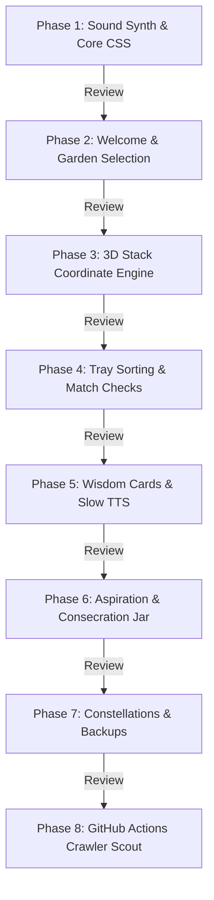

# Implementation Plan — AuroMatch: Educational Mahjong & Concentration Engine

This plan details the architecture and phase-wise engineering of **AuroMatch**. 

> **[IMPORTANT] Strategic Milestone Alignment (V1 vs V2):**  
> * **Phase V1 (Current Live Engine):** Focuses exclusively on **General Knowledge, Student Learning, and Cognitive Skill Building**. Includes the 520-level S-curve progression ladder, reverse-construction solvability engine, 3,840-item multi-disciplinary knowledge corpus, and senior/student accessibility features.  
> * **Phase V2 (Future Planned Expansion):** Dedicated sacred expansion integrating Sri Aurobindo Ashram sanctuaries, Mother's spiritual flower significances, and Darshan rituals (preserved and safely archived in code).

---

## User Review Required

> [!IMPORTANT]
> **Pro Developer - Verification & Transition Rules**
> 1. **Block-by-Block Execution:** We will build only **one phase at a time**. 
> 2. **Mandatory Testing & Logging:** After implementing a phase, we execute automated test suites in `tests/qa_suite.test.js` to ensure 100% solvability and zero regressions.
> 3. **Approval Gate:** The developer agent must present the test results to the user and **wait for review and approval** before proceeding to code the next phase.

---

## Visual Design Concepts Integration

The development of the user interface and game board visual layer integrates three approved design concepts. Developers must refer to [visual_design_concepts.md](file:///c:/DataScience/AuroProject_Annalysis/doc/visual_design_concepts.md) and [thematic_gardens_catalog.md](file:///c:/DataScience/AuroProject_Annalysis/doc/thematic_gardens_catalog.md) for full visual asset mockups and rendering specifications. The 15 spiritual gardens are mapped to these concepts:

1. **Concept 1: The Golden Aura 3D Glass Stack (3D & Light Bloom):**
   * *Features:* 3D glass beveled tile meshes, active tile golden glow filters, hover rotations on select events, and floating 3D vector Sanskrit text.
   * *Associated Gardens:* Auroville Matrimandir Chamber (Theme 3), Auroville Matrimandir Petals (Theme 11), Pondicherry Coastline (Theme 7).
   * *Target Phase:* Phase 1 (Core CSS) & Phase 3 (3D Occlusion Engine).
2. **Concept 2: The Blooming Mandala Garden (2.5D Layered Parallax):**
   * *Features:* Concentric circular levels modeling the Mother's symbol, SVG vector paths, and canvas particle blooms displaying watercolor flowers on clear.
   * *Associated Gardens:* Ashram Samadhi Courtyard (Theme 1), Ashram Playground (Theme 2), Ashram Service Tree (Theme 5), Auroville Banyan Tree (Theme 6), Auroville Green Belt (Theme 12), Pondicherry Botanical Garden (Theme 14).
   * *Target Phase:* Phase 2 (Welcome & Garden Map) & Phase 6 (Lotus Bloom progression).
3. **Concept 3: The Brass Altar & Consecration Fire (Tactile Photorealism):**
   * *Features:* Dark wood backgrounds, bump mapping, physical marble or terracotta tiles with gold-inlay engravings, and HTML5 canvas fluid smoke simulating text dissolution.
   * *Associated Gardens:* SABDA & Ashram Library (Theme 8), Ashram Golconde Dormitory (Theme 9), Ashram Archives (Theme 10), SAICE/SAS/Integral School Classroom (Theme 13), Ashram Dining Hall (Theme 15), Ashram Farms & Lake Estate (Theme 4).
   * *Target Phase:* Phase 6 (Consecration Jar reflection).

---

## Detailed Development Phases

---

### Phase 1: Design Tokens, Layout & Dynamic Sound Synthesis
* **Goal:** Establish the app's visual identity, layout containment, and build the dynamic Web Audio synthesizers (Ashram Gong & time-of-day Raga drones).
* **Components to Build:**
  * Define CSS custom properties for the twilight/garden palette (night-sky blues, forest greens, gold trims).
  * Build the dynamic viewport container using **Dynamic Viewport Height (`100dvh`)** and **Dynamic Viewport Width (`100dvw`)** to ensure auto-resizing across all devices.
  * Build the centered viewport desktop frame (`max-width: 412px`, centered margin) with fluid `clamp()` font functions to prevent text overlapping.
  * Recreate the **Ashram Meditation Gong** (110Hz fundamental + 4 overtone oscillators with 5.0s exponential decay).
  * Build the **Ambient Raga Synthesizer** generating real-time Tanpura drones based on local system time cycles (Bhairav, Sarang, Yaman, Darbari).
* **State Variables Managed:**
  * `audioContext` (State: suspended/active)
  * `gongGainNode`, `droneGainNode`
* **Phase Verification Plan:**
  * Resize the viewport to small widths (320px) and check that text does not overflow.
  * Trigger the gong synthesis; verify decay length and metallic warmth.
  * Trigger the time drones; verify tone quality at various system hours.
  * *Test Log Output:* `AuroMatch/doc/tests/phase1_test_results.md`.

---

### Phase 2: Welcome Screen & Garden Selection
* **Goal:** Render the landing view, map select options, and code the clock-based color theme shifting.
* **Components to Build:**
  * Glassmorphic welcome panel with title and logo.
  * HTML5 Canvas stardust particle background engine (slowly drifting gold dots).
  * Sanctuary level selector map displaying all 15 thematic options (Ashram Samadhi Courtyard, Ashram Playground, Auroville Matrimandir Chamber, Ashram Farms & Lake Estate, Ashram Service Tree, Auroville Banyan Tree, Pondicherry Coastline, SABDA & Ashram Library, Ashram Golconde Dormitory, Ashram Archives, Auroville Matrimandir Petals, Auroville Green Belt, SAICE/SAS/Integral School Classroom, Pondicherry Botanical Garden, and Ashram Dining Hall).
  * Time-of-day color gradient manager (Dawn, Day, Twilight, Night background shifts).
  * Date checker logic for sacred Ashram days to show Darshan greetings.
* **State Variables Managed:**
  * `currentScreen = "welcome"`
  * `activeGarden = null`
  * `currentBgGradient`
* **Phase Verification Plan:**
  * Mock system dates and local hours to verify color gradients shift correctly and Darshan cards load on calendar trigger days.
  * *Test Log Output:* `AuroMatch/doc/tests/phase2_test_results.md`.

---

### Phase 3: 3D Stacking Coordinate Engine
* **Goal:** Project coordinate matrices and implement occlusion checking logic.
* **Components to Build:**
  * 3D Coordinate generator placing tiles on coordinates `(x, y, layer)`.
  * Bounding box collision checker evaluating occlusion rules: a tile is blocked if a higher-layer tile overlaps it.
  * Visual rendering mapping: blocked tiles must be styled with the dark, desaturated filter.
* **State Variables Managed:**
  * `boardTiles = []`
  * `blockedTileIds = []`
* **Phase Verification Plan:**
  * Tap blocked tiles: verify that they reject clicks and play the warning sound.
  * Tap unblocked tiles: verify that they click successfully, slide away, and automatically activate the tiles beneath them.
  * *Test Log Output:* `AuroMatch/doc/tests/phase3_test_results.md`.

---

### Phase 4: Tray Sorting & Match Verification
* **Goal:** Build the 7-slot tray mechanics, automatic clustering, and auto-reshuffle trigger.
* **Components to Build:**
  * The 7-slot tray panel at the top.
  * Dynamic insertion and alphabetical sorting script.
  * Triple matching check: look for 3 adjacent identical tiles, remove them, and launch the success sequence.
  * Reshuffle fallback mechanism: when tray has 7 items with no matches, trigger warning chime and reshuffle remaining active tiles.
* **State Variables Managed:**
  * `trayState = []`
  * `isMatched = false`
* **Phase Verification Plan:**
  * Tap tiles: verify they slide to the tray and sort.
  * Complete three matching tiles: verify they fade from the tray and trigger the gong tone.
  * Fill the tray with 7 unmatched items: verify that it triggers the warning, resets the board, and reshuffles coordinates.
  * *Test Log Output:* `AuroMatch/doc/tests/phase4_test_results.md`.

---

### Phase 5: Wisdom Cards & Slow TTS Narration
* **Goal:** Build the Match Reflection cards and configure the meditative voice playback.
* **Components to Build:**
  * Scripture Card overlays showing flower descriptions, botanicals, or quality quotes.
  * Web Speech API integration with slow rate parameters (`rate = 0.70`, `pitch = 0.95`).
  * Option selector for a French-accented voice to emulate the Mother's reading cadence.
  * Underlined glossary tags for Sanskrit terms to open definition bottom-sheets.
* **State Variables Managed:**
  * `currentOverlay = "wisdom"`
  * `activeSpeechUtterance`
* **Phase Verification Plan:**
  * Open card: verify text legibility and links.
  * Click "Listen": verify slow speed and accent selection.
  * *Test Log Output:* `AuroMatch/doc/tests/phase5_test_results.md`.

---

### Phase 6: Daily Aspiration & Consecration Jar
* **Goal:** Code the morning draw oracle widget and the evening Consecration Jar text dissolution canvas.
* **Components to Build:**
  * Velvet bag oracle view with single draw per day logic.
  * Shortcut code to output drawn qualities as phone launcher widgets.
  * Consecration Jar text input and HTML5 Canvas particle dissolution script.
  * Petal progress system: increment profile petal counts (+5 per level, +10 per journal) and assemble the vector SVG lotus.
* **State Variables Managed:**
  * `lastDrawTimestamp`
  * `hasDrawnToday = true/false`
  * `lotusPetalCount`
* **Phase Verification Plan:**
  * Submit journal entry: verify that character strokes break apart and fall as gold sparkles into the jar.
  * Verify that completed theme chapters run the lotus blooming animation.
  * *Test Log Output:* `AuroMatch/doc/tests/phase6_test_results.md`.

---

### Phase 7: Star Constellations & Secure Local Backups
* **Goal:** Build the Star Calendar grid, monthly vector connectors, and SQLite AES local storage encryption.
* **Components to Build:**
  * Constellation sky grid mapping completed reflection logs as pulsing stars.
  * SVG vector path calculations connecting monthly star nodes.
  * Local database AES encryption mapping key generation toKeychain Services (iOS) and Keystore provider (Android).
  * Manual PBKDF2/AES-256 backup download file utility.
* **State Variables Managed:**
  * `constellationStars = {}`
* **Phase Verification Plan:**
  * Verify that days with saved reflections show pulsing stars, and clicking them displays logged diaries.
  * Test backup file export and import using password decrypt.
  * *Test Log Output:* `AuroMatch/doc/tests/phase7_test_results.md`.

---

### Phase 8: Cloud updates (Scout Service Crawler)
* **Goal:** Build the cloud crawl parser and delta sync merges.
* **Components to Build:**
  * Python parser script to crawl digitized writings on Ashram servers.
  * Dynamic update script in client app checking `version.json` on startup.
  * Safe delta update logic merging new tile definitions without resetting user logs.
* **Phase Verification Plan:**
  * Trigger mock update: verify new levels merge cleanly into the database while personal logs are preserved.
  * *Test Log Output:* `AuroMatch/doc/tests/phase8_test_results.md`.
