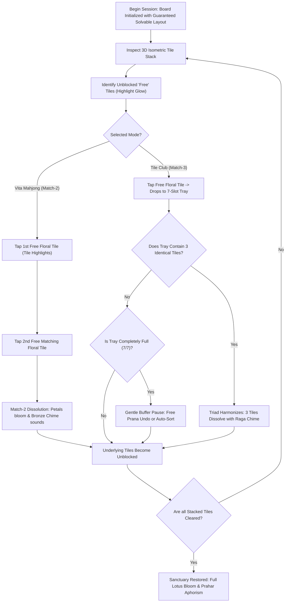

# Game Design Document (GDD): AuroMatch — The Sacred Flora Sanctuary

---

## 1. Document Control & Metadata
* **Game Working Title:** AuroMatch (Subtitle: *The Sacred Flora Sanctuary*)
* **Genre:** Botanical Tile-Matching / Mahjong Solitaire / Zen Sanctuary
* **Target Platforms:** Progressive Web App (PWA), Android (APK / TWA), iOS (WebKit PWA / Native Shell)
* **Target Audience:**
  * **Seniors & Aging Adults (Ages 60+):** Visual cognitive memory, motor tranquility, stress-free matching, zero eye strain.
  * **Children & Youth (Ages 6–14):** Botany, pattern recognition, color sensitivity, calm contemplation.
  * **Family & Intergenerational Pairs:** Collaborative matching with shared cross-generational appreciation.
* **Inspiration & Lineage:** *Vita Mahjong* (126M+ downloads, #1 senior puzzle globally) + *Tile Club* (88M+ downloads, modern 3-tile tray stack mechanics).
* **Guiding Spiritual & Philosophical Principle:** Sacred Botany, Harmony with Nature (*Prakriti*), Quiet Focus (*Ekagrata*), the 12 Divine Qualities of Flowers (Peace, Sincerity, Faith, Gratitude, Aspiration, Purity, Harmony, Devotion, Generosity, Courage, Patience, Humility). *Strictly non-sectarian: Expressed entirely as universal psychological and ecological virtues.*

### Feature Status Registry
* **Vita Mahjong Mode (Match-2 Pairs):** `CONFIRMED`
* **Tile Club Mode (3-Tile Tray Stack):** `CONFIRMED`
* **Reverse Construction Solvability:** `CONFIRMED`
* **Dedicated Senior View Mode [Aa]:** `CONFIRMED`
* **Prahar Solar Clock & 432Hz Ragas:** `CONFIRMED`
* **12 Sacred Botanical Virtues Catalog:** `CONFIRMED`
* **15 Thematic Floral Sanctuaries:** `CONFIRMED`
* **Non-Startle Audio Hum (196Hz):** `CONFIRMED`
* **Ad-Free Voluntary Dakshina Model:** `CONFIRMED`
* **AR Flower Meditation Mode:** `EXPERIMENTAL`
* **Multiplayer Tile Racing:** `REJECTED`
* **Paid Extra Tray Slots:** `REJECTED`
* **Forced Interstitial Video Ads:** `REJECTED`

---

## 2. Core Gameplay Modes

AuroMatch uniquely unifies **two proven tile-matching gameplay styles** within a single serene floral sanctuary:

```
                                  +-----------------------+
                                  |   AuroMatch Sanctuary  |
                                  +-----------------------+
                                              |
                   +--------------------------+--------------------------+
                   |                                                     |
        [ Vita Mahjong Mode ]                                  [ Tile Club Mode ]
        • Classic Pair Match (Match-2)                         • 3-Tile Holding Tray (Match-3)
        • Two open edge-tiles clear                            • 7-Slot Buffer Management
        • Ideal for Seniors & Relaxed Focus                    • Strategic Layer Excavation
```

### 2.1 Mode A: Vita Mahjong (Classic Pair Matching)
* **Rule:** Find and select **two unblocked matching floral tiles**.
* **Clearing:** The pair instantly dissolves in a burst of flower petals, playing a soft bronze raga chime.
* **Accessibility:** Maximum visual simplicity; no holding tray required.

### 2.2 Mode B: Tile Club (3-Tile Sacred Tray)
* **Rule:** Tap unblocked tiles from the 3D stack; each tapped tile drops into a **7-slot wooden holding tray** at the bottom of the screen.
* **Clearing:** When **three identical floral tiles** occupy the tray, they harmonize, bloom, and clear automatically.
* **Tranquil Buffer:** If the tray fills to 7 slots without forming a triad, the board pauses gently with a soft $196\text{ Hz}$ tone and offers an instant, free **Prana Undo** or **Tray Reshuffle**.

---

## 3. Core Gameplay Loop



---

## 4. Reverse Construction Guaranteed Solvability

A frequent grievance in commercial mahjong games is that random tile generation creates mathematically unwinnable boards, forcing players to purchase "reshuffle boosters."

**AuroMatch implements Reverse Construction Solvability:**
* The level layout is populated **backwards from a solved empty board**.
* Pairs (or triads) are placed into currently free top coordinates, ensuring that a 100% clean solution path always exists.

---

## 5. Senior-First Accessibility Innovations

1. **Massive High-Contrast Tiles:** Standard tiles measure $68 \times 88\text{ px}$ with thick $4\text{px}$ bevels.
2. **The `[Aa]` Senior View Mode:** Enlarges all tiles by an additional $+25\%$, centers the camera, and dims occluded background tiles by $50\%$ to maximize visual contrast.
3. **No Startle Audio:** Eliminates harsh game-over buzzers. Soft $196\text{ Hz}$ harmonic hum notifies seniors without triggering sensory alarm.
4. **Zero Timers:** Infinite time to contemplate each move. The game auto-saves synchronously.

---

## 6. The 15 Thematic Floral Sanctuaries

Players journey through 15 tranquil botanical sanctuaries, each dedicated to a serene environment:
1. *The Lotus Basin of Matrimandir*
2. *The Ancient Banyan Grove*
3. *The Golconde Zen Slate Courtyard*
4. *The Service Tree Garden*
5. *The Jasmine Pergola at Dawn*
6. *The Hibiscus Meditation Walk*
7. *The Sacred Champak Terrace*
8. *The Marigold Sunlit Courtyard*
9. *The Gulmohar Canopy of Flame*
10. *The Water Lily Silent Spring*
11. *The White Rose of Purity*
12. *The Sandalwood Fragrant Pavilion*
13. *The Coral Vine Bower*
14. *The Blue Passionflower Bower*
15. *The Crown of Golden Harmony*

---

## 7. Monetization & Ethical Mandate
* **100% Free & Open:** Zero interstitial video interruptions, zero paywalls.
* **Voluntary Dakshina:** Sanctuary patron options for those wishing to support open mindful education.
