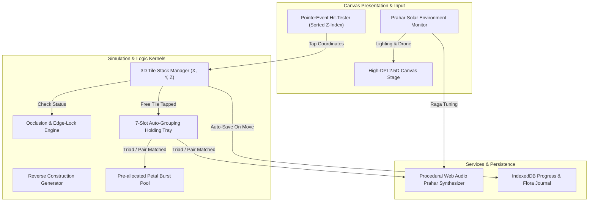

# Technical Architecture Specification: AuroMatch

---

## 1. System Philosophy & Technology Stack

* **Rendering Engine:** HTML5 Canvas 2D with hardware-accelerated DPR subpixel scaling.
* **Core Language:** Pure TypeScript / ES2022.
* **Audio Engine:** Pure procedural Web Audio API ($432\text{ Hz}$ harmonic ragas and bronze chimes).
* **Clock System:** Real-time solar calculator computing sunrise, zenith, sunset, and nadir based on system local time.
* **Persistence:** `IndexedDB` with fallback to `localStorage`.
* **Runtime Dependencies:** `0` (Zero external packages).

---

## 2. System Architecture Diagram



---

## 3. High-Performance Tile Hit-Testing

Because tiles overlap in 3D isometric space, hit-testing must sort candidates by layer $Z$ descending so the top-most tile receives the tap:

```typescript
export class TileHitTester {
  public static findTappedTile(
    touchX: number,
    touchY: number,
    tiles: TileEntity[],
    tileWidth: number,
    tileHeight: number
  ): TileEntity | null {
    // Filter to uncleared tiles and sort by Z descending (highest layer first)
    const candidates = tiles
      .filter(t => !t.isCleared)
      .sort((a, b) => b.z - a.z);

    for (const tile of candidates) {
      const rx = tile.x * (tileWidth / 2) - (tile.z * 2);
      const ry = tile.y * (tileHeight / 2) - (tile.z * 3.5);

      if (touchX >= rx && touchX <= rx + tileWidth &&
          touchY >= ry && touchY <= ry + tileHeight) {
        return tile; // Hit top-most tile!
      }
    }

    return null;
  }
}
```

---

## 4. Cross-Platform Deployment Strategy (PC Browser, Android & iOS)

### 4.1 Single-Source Web-Native Engine & Capacitor Packaging
AuroMatch utilizes a **Single-Source Web-Native Core** wrapped by **Capacitor 6+** for zero-compromise multi-platform execution:
* **PC Desktop Browser:** Served directly via static CDN / PWA. Zero download gate, instant loading, $<500\text{ KB}$ initial bundle.
* **Android (Google Play):** Packaged via Capacitor using Android System WebView, outputting release `.aab` bundles $<4\text{ MB}$.
* **iOS (Apple App Store):** Packaged via Capacitor using Apple `WKWebView`, outputting signed `.ipa` archives $<5\text{ MB}$.

### 4.2 Responsive Viewport Adaptation: Mobile vs. Desktop PC
* **Mobile Viewport ($< 1024\text{px}$):** Portrait frame ($390 \times 844\text{px}$) with oversized $68 \times 88\text{px}$ tiles and safe-area padding for senior accessibility.
* **Desktop PC Viewport ($\ge 1024\text{px}$):** Automatically expands to a **3-Column Sanctuary Layout** ($1920 \times 1080\text{px}$ target):
  - **Left Column ($380\text{px}$):** Restored Living Sanctuary garden visualization, botanical field guide with binomial nomenclature, and senior high-contrast toggle.
  - **Center Stage ($620\text{px}$):** High-DPI interactive 3D isometric tile stacking board with smooth depth offset rendering and golden tile illumination.
  - **Right Column ($380\text{px}$):** 7-slot holding tray (in Tile Club mode) or active matched pair display (in Vita mode), Prahar solar clock, and raga ambient drone synthesizer.

### 4.3 Universal Input Abstraction: PointerEvents & Desktop Keybindings
```typescript
export class AuroMatchUniversalInput {
  private canvas: HTMLCanvasElement;
  private onAction: (action: any) => void;

  constructor(canvas: HTMLCanvasElement, onAction: (action: any) => void) {
    this.canvas = canvas;
    this.onAction = onAction;

    this.canvas.addEventListener('pointerdown', (e) => this.handlePointer(e, 'DOWN'));
    this.canvas.addEventListener('pointermove', (e) => this.handlePointer(e, 'MOVE'));
    this.canvas.addEventListener('pointerup', (e) => this.handlePointer(e, 'UP'));
    this.canvas.addEventListener('pointercancel', (e) => this.handlePointer(e, 'UP'));

    window.addEventListener('keydown', (e) => {
      if (e.key === 'u' || e.key === 'U') this.onAction({ type: 'FREE_UNDO' });
      if (e.key === 'h' || e.key === 'H') this.onAction({ type: 'REQUEST_HINT' });
      if (e.key === 'r' || e.key === 'R') this.onAction({ type: 'RESTART_STAGE' });
      if (e.key === 'Escape') this.onAction({ type: 'TOGGLE_MENU' });
    });
  }

  private handlePointer(e: PointerEvent, phase: string): void {
    const rect = this.canvas.getBoundingClientRect();
    const scaleX = this.canvas.width / rect.width;
    const scaleY = this.canvas.height / rect.height;
    this.onAction({
      type: `POINTER_${phase}`,
      x: (e.clientX - rect.left) * scaleX,
      y: (e.clientY - rect.top) * scaleY,
      pointerId: e.pointerId
    });
  }
}
```

### 4.4 Capacitor Configuration & Build Commands
```json
// capacitor.config.json
{
  "appId": "org.auroproject.auromatch",
  "appName": "AuroMatch",
  "webDir": "dist",
  "plugins": {
    "StatusBar": { "style": "DARK", "backgroundColor": "#0b1215" },
    "Haptics": {}
  }
}
```

```bash
# Multi-Platform Packaging Commands
npm run build                     # Outputs web bundle to dist/
npx cap add android && npx cap add ios
npx cap sync                      # Copies web assets to native Android & iOS projects
npx cap open android              # Generates Android App Bundle (.aab)
npx cap open ios                  # Builds iOS Xcode Archive (.ipa)
```

### 4.5 Audio & Accessibility Integration
* **Autoplay Compliance:** AudioContext is automatically unlocked on first user pointer event.
* **Ambient Audio Session:** iOS audio category configured with `AVAudioSessionCategoryAmbient` so Prahar drones run harmoniously without silencing other system audio.
* **Haptics:** On mobile, unoccluded tile selection triggers light physical haptic confirmation via `@capacitor/haptics`.

